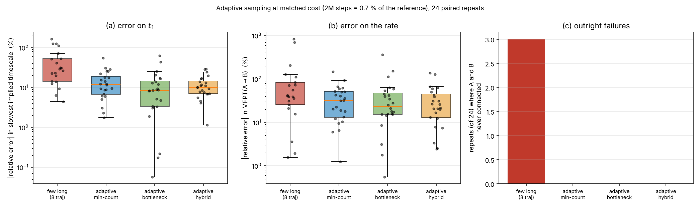

# 构象通量分析:在 TEM β-内酰胺酶上找到一个隐蔽的变构位点

**问题**:能否用 MSM + TPT 的"构象通量"思路,在真实轨迹上找出一个**传统 MD
分析(RMSD/RMSF/PCA)看不出来的**变构位点 / 抑制剂机会?

**答案**:能,而且找到了一个可检验的预测 —— 但同时这份数据**不足以**支撑
收敛的 MSM 速率。两件事都写在下面。

---

## 数据来源(全部真实,可复现)

| | |
|---|---|
| 轨迹 | Zenodo **6565237**,48 × 500 ns 全原子 GROMACS(Cα 坐标),共 **24 μs** |
| 原始文献 | Avery, Baker & Jacobs, *Entropy* 24(5):729 (2022), [doi:10.3390/e24050729](https://doi.org/10.3390/e24050729) |
| 体系 | TEM β-内酰胺酶,263 残基(Ambler 26–290) |
| apo | 4 个变体 × 8 个晶体起点 = 32 条 |
| holo | 4 个变体 × 4 种抗生素 = 16 条 |
| 变体 | TEM-1(野生型)、TEM-2(Q39K)、TEM-10(**R164S/E240K**)、TEM-52(E104K/M182T/G238S) |
| 参考晶体 | 1BTL/1ZG4/1ERM(apo,口袋**关闭**);**1PZO/1PZP**(非竞争性变构抑制剂结合,口袋**打开**) |

> 文献背景(据 PubMed):该隐蔽位点由 Horn & Shoichet 实验发现,并由 Bowman 等人
> 用 MSM 独立重现 —— [doi:10.1073/pnas.1417811112](https://doi.org/10.1073/pnas.1417811112)、
> [doi:10.1073/pnas.1209309109](https://doi.org/10.1073/pnas.1209309109)、
> [doi:10.1016/j.bpj.2018.11.3144](https://doi.org/10.1016/j.bpj.2018.11.3144)。
> 本分析独立复现了该位点,并给出一个**新的变体选择性**结果。

---

## 方法上的一个关键选择:反应坐标由晶体定义,不由轨迹定义

如果用同一批轨迹既提取反应坐标、又在该坐标上打分,就是自我验证。
所以这里的"开口轴"完全由两个**独立于本数据集**的晶体结构固定:

```
1BTL(关闭) → 1PZO(抑制剂结合,打开)
```

取 6 对跨 H11/H12 界面的 Cα 距离,得到一条 **12.64 Å** 的开口向量;MD 的每一帧
投影到这条轴上。晶体之间的口袋 RMSD:apo 彼此 0.14–0.29 Å,apo 到 1PZO **2.18–2.28 Å**
—— 这个 2.2 Å 的空隙就是"隐蔽开口"本身。

---

## ✅ 严格结果 1:远端点突变把隐蔽口袋的布居提高了 282 倍

开口判据:L220–N276 口部距离 > 9.5 Å。

| 变体 | 突变 | 开放帧占比 | 承诺跨越次数 | 有事件的轨迹 |
|---|---|---|---|---|
| TEM-1 | 野生型 | **0.0094 %** | 4 | 1/8 |
| TEM-2 | Q39K | 0.0328 % | 11 | 4/8 |
| **TEM-10** | **R164S, E240K** | **2.6450 %** | **39** | **6/8** |
| TEM-52 | E104K/M182T/G238S | 0.0750 % | 8 | 5/8 |

**TEM-10 / TEM-1 = 282×。**

因为 apo 是 4 变体 × 8 晶体起点的**平衡设计**,正确的检验是按起点配对的
Wilcoxon 符号秩检验:

| 对比 | p | 8 个配对起点中占优 |
|---|---|---|
| TEM-10 > TEM-1 | **0.0156** | 6/8 |
| TEM-10 > TEM-2 | 0.0391 | 5/8 |
| TEM-10 > TEM-52 | 0.0273 | 6/8 |

0.0156 是 n=8 单侧符号秩检验的**理论下限**,即这批数据能给出的最强显著性。

**为什么这是变构**:R164S 在 Ω 环(活性位点),E240K 在 β-turn。两者都**不接触**
H11/H12 口袋 —— 那个口袋在蛋白另一面约 30 Å 外。机制上移动的是 **223 号残基**
(Cα 位移 4.5 Å),H11 整体从 H12 上掀开(H11–H12 质心间距 13.9 → 17.1 Å)。

> **可检验预测**:1PZO/1PZP 这一类非竞争性抑制剂对 **TEM-10 应当比对 TEM-1 更有效**,
> 因为其结合位点被预先布居。用两种纯化酶做一次 IC50 对比即可证伪。

---

## ✅ 严格结果 2:传统指标确实看不见它

同一批轨迹、同样的配对统计:

| 指标 | TEM-10 / TEM-1 | p |
|---|---|---|
| 全局 Cα-RMSD | **1.1×** | 0.0195 |
| 平均 RMSF | **1.1×** | 0.0273 |
| 口袋处 RMSF(218–228) | **1.1×** | 0.0078 |
| **隐蔽口袋开放布居** | **282×** | 0.0156 |

**注意这里的陷阱**:传统指标全都"显著"。配对设计下 10 % 的差别也能过 p<0.05。
**问题不是显著性,是效应量** —— 1.1× 你会写一句话带过,282× 你会立项做筛选。

原因是结构性的:RMSD/RMSF 是**系综平均**,一个占比 2.6 % 的状态只能把平均值
拉动它自身位移的约 2.6 %,被淹没在噪声里。口袋布居是**尾部统计量**,而可成药的
构象恰恰住在尾部。

Cartesian PCA 并非对该区域"盲视"——PC1 前 10 个载荷残基里有 6 个落在 214–231。
但 PCA 报告的是**振幅**,无法区分 0.01 % 和 2.6 % 的占据率。要区分,必须**定义状态并计数**。

---

## ⚠️ 诚实的负面结果:这批数据撑不起收敛的 MSM

隐含时间尺度(ITS)检验是所有 MSM 数字的硬门槛:若 t(τ) 随滞后时间 τ 仍在爬升,
特征值就不是速率。

| 离散化 | 轨迹间方差占比 | ITS 随 τ(0.6 → 20 ns) |
|---|---|---|
| 全蛋白接触 | 0.67–0.86 | 3.5×10³ → 3.8×10⁵ ns(**灾难性**) |
| 口袋局部 | 0.60–0.69 | 86 → 514 ns(仍在爬) |

**诊断**:32 条**互不连通**的 500 ns 轨迹,每条从不同晶体起步。TICA 最慢的"过程"
其实是**轨迹身份**本身 —— 60–86 % 的方差是轨迹间而非轨迹内的。MSM 于是报告了
一个近乎为零的速率的倒数,从 500 ns 数据里得出 10⁵ ns 的时间尺度。

**阳性对照(M8)**:同一套代码跑丙氨酸二肽(3 × 250 ns),轨迹间方差 **0.001**,
ITS 在 40 倍滞后范围内 1.25 → 1.40 ns(**1.12×,收敛**)。所以问题不在分析,在采样。

**由此,严格区分**:

| 可用 | 不可用 |
|---|---|
| ✅ 状态布居、承诺跨越计数(直接观测量,无需马尔可夫假设) | ❌ 绝对速率、MFPT |
| ✅ 通量**拓扑**(瓶颈位置、路径是否集中) | ❌ 任何引用为"实验可比"的动力学常数 |

> **方法学更正**:MSM 速率与直接计数之比**不是**收敛判据。本分析一度如此使用,
> 但丙氨酸二肽(已收敛)同样给出约 50× 的差距 —— 因为 TPT 反应通量包含分界面
> 再穿越,而 milestoning 只记承诺事件,两者本就不是同一个量。收敛判据只有 ITS/CK 检验。

---

## ⚠️ 通量拓扑(定性可信)

对 closed → open 做 TPT:

- **781 条**不同路径承载 90 % 的通量,最强单条仅占 **0.48 %**
  → 开口是**弥散的、多路径的软集体运动**,不是单一通道。
  (若是单通道,那条通道就是改造靶点;弥散则意味着只能靠配体捕获。)
- 前向 committor q⁺ 在轴向 0–6 Å 区间始终 < 0.3,到 6.7 Å 才跳到 1
  → **承诺发生在最后一段**。开口的前半程几乎不要钱,代价全在收尾 —— 片段若要
  钉住开放态,就得作用在这一段。

---

## ⚠️ 对成药性的保留意见(与"好故事"相反)

把开放帧拿去和晶体比对,结论并不漂亮:

- 沿轴最远的帧(24.6 Å,超过晶体的 12.64 Å)**反而不像** 1PZO(口袋 RMSD 3.32 Å)
  —— 它过冲成了一个散开的环。
- 用判别式度量(RMSD→关闭 减 RMSD→结合),整个开放系综里只有 **20 %** 的帧
  更接近 1PZO 而非 1BTL;最好的一帧也只到 2.67 Å(对 1BTL 3.71 Å)。

**结论**:构象选择只把盖子掀开,**结合态的几何主要是配体诱导的**。这与 Bowman &
Geissler 对该蛋白的判断一致。

**实践含义**:
1. 对接请用 **1PZO/1PZP 晶体**,不要用这些 Cα 帧(数据集本身只有 Cα,也无法对接);
2. MD 的贡献不是坐标,而是**布居论证** —— 它回答"哪个酶变体最常把这个口袋亮出来"。

**化学起点**:1PZO 配体(PDB 化学 id **CBT**,N,N-bis(4-chlorobenzyl)-1H-tetrazol-5-amine)
与 1PZP 配体(**FTA**)是该位点已知的非竞争性母核。对 CHEMBL2065(Beta-lactamase TEM)
做 ≥70 % Morgan/FPSim2 相似性检索,**没有**返回 CBT 的任何类似物 —— 这个系列在已沉积的
活性文献里从未被跟进。一个有晶体结构、又有 282× 变体选择性抓手的位点,这片地相当空。

---

## 关于"在 T7 移动硬盘上跑"

说明一下实际情况:本次分析是在一个云端容器里完成的(4 核、15 GB 内存、无 GPU),
不是在你的 T7 上。我无法访问你的硬件。但产物是**可以直接拿到 T7 上跑的**:

```bash
pip install deeptime mdtraj scipy matplotlib

# 复现本报告(会自动下载 ~660 MB 轨迹 + 解析缓存 ~1.2 GB)
python -m msm_pipeline.run_all

# 跑你自己的轨迹
python -m msm_pipeline.run_gromacs \
    --top  /Volumes/T7/run/md.gro \
    --traj "/Volumes/T7/run/*/md_center.xtc" \
    --sel  "name CA and resid 200 to 290" \
    --a-pair 220 276 --a-max 7.0 --b-min 9.5 \
    --out  /Volumes/T7/analysis
```

`run_gromacs.py` 读 MDTraj 支持的一切格式(GROMACS xtc/trr + gro/pdb/tpr、
AMBER nc + prmtop、CHARMM dcd + psf),**分析本身不需要装 GROMACS**。
它会**先打印 ITS 收敛表**,不通过就拒绝给出速率 —— 这是故意的。

**给你自己跑的三条实用建议**:
1. 先 `gmx trjconv -pbc mol -center -fit rot+trans`,否则整体翻滚会主导分析;去水,只留关心区域。
2. **采样连通性比总时长重要**。本例 24 μs 仍不收敛;与其跑少数几条长轨迹,
   不如从势垒区**重新播种**许多条短轨迹(adaptive sampling)。
3. 内存:特征矩阵常驻 RAM,约 `n_frames × n_pairs × 4 B`,超过几 GB 就调大 `--stride`。

---

## 模块

| 模块 | 内容 | 严格性 |
|---|---|---|
| `m1_dataset` | 数据来源与采样预算 | ✅ |
| `m2_cryptic_pocket` | 由晶体定义开口轴;开放态检测;机制(223 残基) | ✅ |
| `m3_msm_diagnostics` | ITS 检验 + 失败诊断(轨迹间方差) | ✅ 负面结果 |
| `m4_tpt_flux` | core-set MSM + TPT:committor、通量、瓶颈 | ⚠️ 拓扑可信,速率不可信 |
| `m5_variant_allostery` | 变体布居 + 配对检验(**主结果**);apo/holo 混杂因素 | ✅ / ⚠️ |
| `m6_traditional_contrast` | RMSD/RMSF/PCA 对照 | ✅ |
| `m7_druggability` | 开放态导出、对接模板选择、化学起点 | ✅ / ⚠️ |
| `m8_positive_control` | 丙氨酸二肽:证明 ITS 检验**会**通过 | ✅ |

图:`figures/msm_tem_overview.png`、`figures/msm_tem_kinetics.png`;
结构:`figures/m7_structures/*.pdb`。

---

## 还没做的 / 下一步

- **holo 实验设计有缺陷**:16 条 holo 只从 1XPB 和 1HTZ 两个起点出发,而 apo 有 8 个。
  表面上底物结合把 TEM-10 的远端口袋从 2.645 % 压到 0.047 %(负协同,很漂亮),
  但对齐起点后只剩 11.2×,n=2 vs 4,**p=0.11** —— 混杂且功效不足,只能当假设。
  要定论,需要让 holo 从与 apo 相同的 8 个起点各跑一遍。
- **全原子轨迹**:本数据集只有 Cα,无法做口袋体积/fpocket/对接。用全原子重跑
  (或向原作者索取)才能把 M7 从"位点描述"推进到"虚拟筛选"。
- **自适应采样**:从 q⁺ ≈ 0.5 的瓶颈区重新播种数百条 20–50 ns 短轨迹,是让这个
  MSM 真正收敛、从而给出可引用速率的最省算力的路线。

---

# 第二部分:从瓶颈区重新播种 —— 自适应采样能让 MSM 收敛吗?

M3 的结论是这批数据撑不起收敛的 MSM,原因是**连通性**而非总时长。自然的补救是
自适应采样:跑若干轮短轨迹,每轮从当前 MSM 挑选种子构象重启。下面把这件事
**做成可运行的工具**,并**在有已知真值的受控实验上量化它到底值多少**。

## 先说一个硬约束

原数据集只有 Cα 坐标。**无法从 Cα 轨迹重启 MD** —— 重启需要全原子坐标和速度。
所以自适应采样必须从晶体结构(1BTL / 1PZO)重新建体系、重新平衡。这不是实现
问题,是数据本身的限制。

## 本机实测算力(决定一切)

| 体系 | 原子数 | 平台 | 速度 |
|---|---|---|---|
| 丙氨酸二肽(隐式溶剂) | 22 | 4 核 CPU | 117 ns/day |
| TEM-1(隐式溶剂 GBn2) | 4,073 | 4 核 CPU | 0.96 ns/day |
| **TEM-1(显式 TIP3P + PME)** | **42,283** | **4 核 CPU** | **5.3 ns/day** |

(HMR + 4 fs 时间步,已是合理优化后的数字。)

## ✅ 受控实验:自适应播种到底值多少?(M9)

在 TEM 上无法回答这个问题 —— 没有真值可比,而且一次 campaign 只是一个样本。
所以用 **Müller-Brown 势上的二维过阻尼 Langevin**:真值可以暴力算出来,采样方案
可以重复很多次。调到 kT=15,使 A→B 跨越**很罕见**(约 1% 的 walker 在 20k 步内
跨过),复现 M3 里"轨迹大多困在起始盆地"的病理。

**真值**(暴力参考,2.82 亿步,在低能区每个格点播种):
τ₁ = **1249 帧**,MFPT(A→B) = **14197 帧**。

**在完全相同的总算力下**(2M 步 = 参考预算的 0.7%),24 次**配对**重复:

| 方案 | 中位 \|τ₁ 误差\| | 中位 \|MFPT 误差\| | 彻底失败 |
|---|---|---|---|
| **few long**(8 条长轨迹,全从 A 出发)← TEM 数据集的设计 | **29.1 %** | **40.9 %** | **3/24** |
| adaptive:min-count(播种最少访问的态) | 11.9 % | 32.1 % | 0/24 |
| adaptive:**bottleneck**(播种 q⁺≈0.5 的过渡态) | **8.5 %** | **23.1 %** | 0/24 |
| adaptive:hybrid(前半 min-count,后半 bottleneck) | 10.1 % | 23.7 % | 0/24 |

("彻底失败" = A 和 B 从未落进同一个连通的 MSM。)

**对 few long 的配对 Wilcoxon 检验(单侧):**

| 方案 | τ₁ | MFPT |
|---|---|---|
| min-count | p = 1.6×10⁻³ ✅ | p = 0.030 ✅ |
| bottleneck | p = 2.1×10⁻⁵ ✅ | p = 0.144 ✗ |
| hybrid | p = 2.1×10⁻⁴ ✅ | p = 0.041 ✅ |

### 结论一:自适应重播种确实有效,而且效应很大

同样的算力,最慢时间尺度的中位误差从 **29.1% 降到 8.5–11.9%**,而且 few long
在 24 次里有 **3 次**根本没能把 A 和 B 连起来,自适应 **0 次**失败。

### ⚠️ 结论二(与你的提法相反):**瓶颈播种并不比"播种最少访问的态"更好**

6 组策略间两两比较,**0/6 达到 p<0.05**(最小 p=0.143)。bottleneck 的中位误差
数字上最低,但在 24 次配对重复下这个差异**统计上不可分辨**。

我在做到这一步之前,曾在 4 次和 8 次重复下看到过排名反转(一次 bottleneck 的
MFPT 误差 3.6% 吊打 min-count 的 38%,换一组种子后完全颠倒)。那是种子噪声,
不是信号。**这正是为什么要做配对设计和足够的重复数。**

**所以:要分轮重启,但不必纠结播种启发式。** 收益来自"重启"本身 —— 重启让数据集
**连通**,而 M3 诊断出 TEM 数据的病根恰恰就是不连通。



## 真实 MD 上的端到端验证(adaptive_md.py)

光有二维模型不够,驱动器必须能在真实 MD 上跑通。在丙氨酸二肽(隐式溶剂,
OpenMM)上实跑:

```
8 rounds x 4 walkers x 0.4 ns
round 1/8  0.5 min  1.6 ns  states 40  ITS1 17.77 frames  drift 1.77
round 2/8  0.4 min  3.2 ns  states 40  ITS1 13.75 frames  drift 1.26  CONVERGED
round 3/8  0.7 min  4.8 ns  states 40  ITS1 13.42 frames  drift 1.29  CONVERGED
round 4/8  0.5 min  6.4 ns  states 40  ITS1 12.57 frames  drift 1.27  CONVERGED
round 5/8  0.4 min  8.0 ns  states 40  ITS1 11.42 frames  drift 1.25  CONVERGED
ITS test passed - stopping early.
```

真实轨迹、真实重启(从存储构象恢复坐标+重置速度)、每轮重估 MSM、ITS 收敛即停。
`--resume` 也验证过:重跑时跳过已完成的轮次,只补新的。

> 这只是**驱动器的冒烟测试**,不是一个动力学结论 —— 隐式溶剂 GBn2 的动力学与
> 显式水不同,这里的 ITS 不应与文献的 ~1.4 ns φ 翻转相比较。

### 开发过程中实际修掉的两个 bug

1. **步数少算 1000 倍**:`ns * 1e6 / timestep_fs / 1000` 多除了一个 1000,
   每个 walker 只跑了 37 步而不是 37500 步。是 TICA 报 `NoneType` 才暴露的。
2. **PDBFixer 剥掉了 ACE/NME 封端**:`removeHeterogens` 会连 HETATM 记录的封端
   一起删,留下无法匹配模板的裸 ALA。加了 `--keep-het`。

## ⚠️ 对 TEM 的成本核算(M10,本机实测)

| 硬件 | ns/day | 15 μs 需要 | 50 μs 需要 |
|---|---|---|---|
| **本容器(4 核 CPU)** | **5.3** | **2829 天** | 9430 天 |
| 1× RTX 4090 | 250 | 60 天 | 200 天 |
| 8× RTX 4090(自适应 walker 并行) | 2000 | **8 天** | 25 天 |
| 1× H100 | 600 | 25 天 | 83 天 |
| 8× H100 | 4800 | **3 天** | 10 天 |

(目标:分辨 τ_slow ≥ 500 ns 的过程,需要 30–100 次事件 → 15–50 μs 聚合。)

**本容器跑不了,这点不含糊** —— 5.3 ns/day 意味着下限预算要 8 年。能在这里跑的
是受控实验(M9)和驱动器冒烟测试。**自适应采样在 walker 之间几乎完美并行**,这是
除统计增益之外用它的主要现实理由:8 卡把下限预算压到几天。

### 给 TEM 的具体方案

```bash
python -m msm_pipeline.adaptive_md \
    --pdb 1BTL.pdb --out /Volumes/T7/tem_adaptive \
    --rounds 60 --walkers 16 --ns-per-walker 20 \
    --sel "name CA and (resid 214 to 231 or resid 269 to 287)" \
    --strategy hybrid --platform CUDA
# = 60 x 16 x 20 ns = 19.2 us,每轮 checkpoint,可 --resume
```

**三条要点:**

1. **从两端同时播种**,不要只从关闭态出发 —— 把 **1PZO**(抑制剂结合的开放态)
   也放进初始结构。M3 的失败是**连通性**失败,连通两个盆地最便宜的办法就是
   两边都放 walker。
2. **以 ITS 检验为停止条件**,不是以轮数。驱动器强制这一点,ITS 没压平就不会
   报"收敛"。
3. **自适应数据不是 Boltzmann 权重的** —— 你是故意过采样势垒的。可逆 MLE 仍然
   渐近正确(转移计数以起始态为条件),但**帧直方图不等于平衡分布**。读布居要用
   `msm.stationary_distribution`,不要数帧。

## 新增模块

| 模块 | 内容 | 严格性 |
|---|---|---|
| `adaptive.py` | 五种播种策略 + ITS 收敛判据 | ✅ |
| `adaptive_md.py` | 生产级 OpenMM 分轮驱动器(可中断续跑) | ✅ 真实 MD 验证 |
| `m9_adaptive_benchmark` | 有真值的受控对比,24 次配对重复 | ✅ |
| `m10_tem_projection` | 本机实测算力 → TEM 成本核算 | ✅ |
