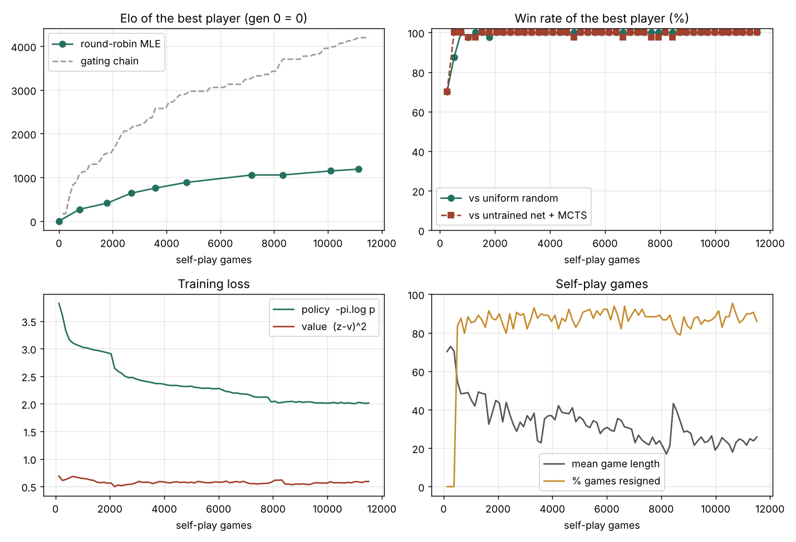

# AlphaGo Zero 精简复现：7×7 围棋

按照 *Mastering the Game of Go without Human Knowledge*（Silver et al., Nature 550, 354–359, 2017）的方法，从零训练一个 7×7 围棋 AI。除了围棋规则，它没有用到任何人类知识：没有棋谱、没有定式、没有手工特征。

- 训练：`python -m alphago_zero.train`（4 核 CPU，约 2.5 小时）
- 终端对弈：`python -m alphago_zero.play`
- 网页对弈：直接用浏览器打开 `alphago_zero/web/go_zero.html`（单文件，模型和引擎都在里面，不需要服务器）

> 关于两个链接：`nature16961` 是 2016 年的初代 AlphaGo（*Mastering the game of Go with deep neural networks and tree search*），UCL 的 PDF 才是 AlphaGo Zero。两者的区别见第 1 节。这里实现的是 AlphaGo Zero。

---

## 1. 初代 AlphaGo 和 AlphaGo Zero 的区别

| | AlphaGo（2016, nature16961） | AlphaGo Zero（2017） |
|---|---|---|
| 起点 | 用 KGS 上约 3000 万个人类局面做监督学习（策略网络预测人类落子，准确率 57%） | 随机初始化，不看任何人类棋谱 |
| 网络 | 两个独立网络：策略网络 + 价值网络（13 层卷积），外加一个快速走子网络 | **一个**残差网络，两个输出头：策略 `p` 和价值 `v` |
| 输入 | 48 个手工特征平面（气、征子、提子数等） | 17 个平面，只有黑白棋子位置和轮到谁 |
| 强化学习 | 策略梯度（REINFORCE）自我对弈，再用这些对局训练价值网络 | MCTS 搜索结果直接当训练目标（策略迭代） |
| 叶子评估 | `(1−λ)·v + λ·rollout 结果`，需要随机走子到终局 | 只用 `v`，没有 rollout |
| 结果 | 战胜樊麾、李世石 | 3 天训练后 100:0 战胜 AlphaGo Lee |

AlphaGo Zero 更简单，也更强。把人类数据、手工特征和 rollout 全部拿掉之后，系统反而更强了。

---

## 2. AlphaGo Zero 的训练过程

### 2.1 核心思想：MCTS 是一个“策略改进算子”

网络 `f_θ(s) = (p, v)`：给定局面 `s`，`p` 是每个落子点的概率，`v ∈ [-1, 1]` 是当前行棋方的胜率估计。

用 `f_θ` 引导一次 MCTS 搜索后，根节点各子节点的访问次数分布 `π` 通常比原始的 `p` **更强**。所以：

- **策略改进**：搜索把 `p` 变成更好的 `π`，然后训练 `p` 去模仿 `π`。
- **策略评估**：用搜索策略自我对弈到终局，胜负 `z` 就是对局面价值的无偏样本，训练 `v` 去拟合 `z`。

网络变强，下一轮搜索就更强；搜索更强，训练目标也更强。这就是论文里说的 *self-play reinforcement learning with lookahead search*，本质上是广义策略迭代（generalized policy iteration）。

### 2.2 一次 MCTS 模拟（论文 Fig. 2 / Methods "Search algorithm"）

每条边 `(s, a)` 存四个量：访问次数 `N`、总价值 `W`、平均价值 `Q = W/N`、先验 `P`。

1. **选择（Select）**：从根节点往下，每层选
   `a = argmax_a [ Q(s,a) + U(s,a) ]`，`U(s,a) = c_puct · P(s,a) · √(Σ_b N(s,b)) / (1 + N(s,a))`
   `U` 一开始偏向先验高的点，访问多了以后衰减，搜索逐渐偏向 `Q` 高的点。
2. **扩展与评估（Expand & evaluate）**：走到没展开过的叶子 `s_L`，随机选一个 8 种对称变换 `d_i`，调用一次网络 `(p, v) = f_θ(d_i(s_L))`，用 `p` 初始化所有子边的 `P`，`N = W = Q = 0`。**没有 rollout。**
3. **回传（Backup）**：沿路径向上，`N += 1`，`W += v`（每层换一次符号，因为双方轮流）。

1600 次模拟后，按 `π(a) ∝ N(s₀, a)^(1/τ)` 选棋。

### 2.3 自我对弈（数据生成）

- 每步做 1600 次模拟；搜索树在下一步**复用**（选中的子树变成新根）。
- **探索**：根节点先验加 Dirichlet 噪声 `P = (1−ε)p + ε·η`，`η ~ Dir(0.03)`，`ε = 0.25`。
- **温度**：前 30 手 `τ = 1`（按访问次数比例抽样），之后 `τ → 0`（选访问最多的）。
- **认输**：根节点价值和最佳子节点价值都低于 `v_resign` 就认输。`v_resign` 自动校准：随机留 10% 的对局禁止认输，下到终局，用它们统计“本来会认输、结果却赢了”的比例，保持在 5% 以下。
- 每个局面记录 `(s_t, π_t, z_t)`，`z_t = ±1` 是终局时当前行棋方的胜负。
- 规则：Tromp–Taylor 数子法，贴目 7.5，双方连续停手或超过 19×19×2 手终局。

### 2.4 训练（优化器）

- 从最近 50 万局的所有局面里均匀采样，批大小 2048，每个样本随机做 8 种旋转/翻转之一（数据增强）。
- 损失函数：

  ```
  l = (z − v)²  −  πᵀ log p  +  c‖θ‖²         c = 10⁻⁴
      价值回归     策略交叉熵     L2 正则
  ```

- SGD + 动量 0.9，学习率 10⁻² → 10⁻³ → 10⁻⁴ 分段退火。每 1000 步存一个 checkpoint。

### 2.5 评估（守门员）

每个新 checkpoint 和当前“最强网络” `α_θ*` 下 400 局（1600 次模拟，`τ → 0`）。胜率 **超过 55%** 才替换最强网络，之后由它生成自我对弈数据。这样保证数据始终来自当时最强的玩家。

（一年后的 AlphaZero 去掉了这一步，直接用最新网络自我对弈。本实现保留它，也可以用 `--gating false` 关掉。）

### 2.6 网络结构

```
输入 17×19×19:  [X_t, Y_t, X_{t-1}, Y_{t-1}, …, X_{t-7}, Y_{t-7}, C]
                X = 己方棋子，Y = 对方棋子，C = 全 1（黑走）或全 0（白走）
  └ conv 3×3, 256 → BN → ReLU
  └ 19 或 39 个残差块：conv-BN-ReLU-conv-BN + 跳连 → ReLU
  ├ 策略头：conv 1×1, 2 → BN → ReLU → 全连接 → 362 个 logit（361 点 + 停一手）
  └ 价值头：conv 1×1, 1 → BN → ReLU → 全连接 256 → ReLU → 全连接 1 → tanh
```

需要 8 步历史的原因：围棋有打劫/全局同形禁着，只看当前盘面无法判断哪些点不能下。

### 2.7 三个组件异步并行

论文里自我对弈、训练、评估同时在不同机器上运行。本实现按固定顺序轮流执行（自我对弈 → 训练 → 评估 → 再自我对弈），算法相同，只是调度更简单。

---

## 3. 代码对照

| 文件 | 内容 | 对应论文 |
|---|---|---|
| `go.py` | 围棋规则：提子、自杀禁止、全局同形（Zobrist 哈希）、Tromp–Taylor 数子；17 平面输入特征；8 种对称变换 | Methods: *Domain knowledge*, *Neural network architecture*（输入） |
| `model.py` | 双头残差网络 | Methods: *Neural network architecture* |
| `mcts.py` | PUCT 搜索：选择 / 扩展评估（随机对称）/ 回传；Dirichlet 噪声 | Methods: *Search algorithm* |
| `selfplay.py` | 自我对弈（温度、树复用、认输与校准数据）；对弈场（评估、对随机棋手） | Methods: *Self-play*, *Evaluator* |
| `train.py` | 主循环：自我对弈 → 采样+增强 → SGD → 守门评估 → 晋级 | Methods: *Optimization*, Fig. 1 |
| `analyze.py` | 各代循环赛拟合 Elo、最终强度测试、训练曲线、示例棋谱 SGF | Fig. 3 |
| `play.py` | 终端人机对弈 | |
| `export_web.py`, `web/` | 把网络（BN 折叠进卷积）和 JS 版引擎打包成单文件网页 | |
| `test_go.py`, `web/check_parity.py` | 规则单元测试；JS 引擎与 Python/PyTorch 逐项比对 | |

**一个工程细节**：论文用多线程 + virtual loss 让一次网络调用评估多个叶子。这里换成“同时下很多盘棋，每盘各走一次模拟，把所有叶子拼成一个 batch 送进网络”。每棵树内部的搜索与论文完全一致，只是 CPU 利用率更高。

---

## 4. 运行

```bash
pip install torch numpy matplotlib
```

```bash
python -m alphago_zero.test_go                      # 规则测试
python -m alphago_zero.train                        # 训练（默认 150 分钟预算）
python -m alphago_zero.train --time-budget-min 10 --sims 32 --out-dir /tmp/smoke   # 快速试跑
python -m alphago_zero.train --resume               # 中断后继续
python -m alphago_zero.analyze                      # 循环赛 Elo + 曲线图 + 示例棋谱
python -m alphago_zero.play --color white --sims 400
python -m alphago_zero.export_web                   # 重新生成网页
```

所有超参数都在 `config.py`，每个参数旁边注明了论文里的取值，命令行可以覆盖（如 `--board-size 9 --blocks 6 --filters 64`）。

---

## 5. 训练结果

在 4 个 CPU 核上训练约 152 分钟（中途沙箱重启两次，用 `--resume` 接着训练），共 90 轮、11,520 盘自我对弈、约 38 万个训练局面，44 个候选网络通过 55% 门槛晋级。



**各代循环赛 Elo**（`analyze.py`：从 45 代里均匀取 10 代，每对下 20 局，每步 50 次模拟，Bradley–Terry 最大似然拟合，第 0 代 = 0）：

| 代 | 0 | 5 | 10 | 15 | 20 | 24 | 29 | 34 | 39 | 44 |
|---|---|---|---|---|---|---|---|---|---|---|
| 自我对弈局数 | 0 | 768 | 1,792 | 2,688 | 3,584 | 4,736 | 7,168 | 8,320 | 10,112 | 11,136 |
| Elo | 0 | 269 | 410 | 639 | 755 | 885 | 1055 | 1055 | 1148 | 1188 |

**最终网络（第 44 代，每步 200 次模拟）**：对均匀随机棋手 100 局全胜；对未训练的随机网络（同样带 200 次搜索）100 局全胜。

几点观察：

- **强度单调上升**，前 3,000 局涨得最快，之后放缓。曲线形状和论文 Fig. 3a 相似，只是规模小得多。
- **“评估链 Elo”（灰色虚线，约 4200）严重高估**。每次晋级都是在 40 局里刚好赢够 55% 才发生，带有选择偏差，累加起来就会虚高。循环赛的数字（约 1190）才可靠。论文用 400 局评估，这个偏差小得多。
- **价值损失停在 0.55 左右**。7×7 对局很短，开局阶段胜负本来就难以预测（贴 8.5 时自我对弈里白棋约赢 75%），这是数据本身的噪声下限，不是没学会。
- **策略损失在约 2,000 局和 8,000 局处各有一个台阶**，对应两次中断后恢复训练：恢复时经验池从空开始，新数据被反复训练了几遍。第二次恢复还恰好碰上学习率降 10 倍。
- **认输**：价值头学会之后，约 85–90% 的自我对弈以认输结束，校准对局里的误判率（本来会认输、最后却赢了）平均 4%，每轮只有十几盘校准对局，所以单轮数值波动较大，平均对局长度从 70 手降到 25 手左右，节省了大量算力。论文里认输的作用也是这个。
- `runs/7x7/sample_games.sgf` 是最终网络自我对弈的 3 盘棋（每步 400 次模拟），可以用任何 SGF 软件打开。

**在线对弈**：网页版和训练用的是同一个网络，JS 引擎和 Python 引擎在 311 个随机局面上逐项比对过（落子合法性、数子结果完全一致，网络输出误差 < 10⁻⁵）。

---

## 6. 和论文不同的地方

为了在 4 个 CPU 核上几小时内跑完，做了这些缩小或改动：

1. **规模**：7×7 棋盘（贴 8.5；7×7 在数子法下黑棋最优可胜 9 目），4 块 × 48 通道的网络（约 18 万参数，论文 20 块版约 2300 万），每步 100 次模拟（论文 1600），Dirichlet α = 0.25（按“约 10 / 合法步数”缩放），前 8 手抽样（论文 30 手）。
2. **评估只下 40 局**（论文 400 局），55% 门槛下运气成分较大，偶尔会让没有变强的网络晋级。所以训练曲线里“评估链 Elo”偏高，`analyze.py` 另做循环赛用最大似然重新拟合 Elo。评估时前 2 手按访问次数抽样，避免 40 局变成几盘重复棋。
3. **训练量按数据量自适应**：每轮训练步数 = 4 × 新局面数 / 批大小；学习率按时间预算的 65% 和 90% 处各降 10 倍。
4. **策略目标**：存的是访问次数分布 `N/ΣN`（τ = 1），与走棋时用的温度无关。这是多数复现（Leela Zero、Minigo）的做法；论文对此描述不完全明确。
5. **认输阈值**上限设为 −0.8，避免价值头还没学好时过早认输。
6. **同步调度**代替异步集群，batch 化的多局并行代替 virtual loss（见第 3 节）。
