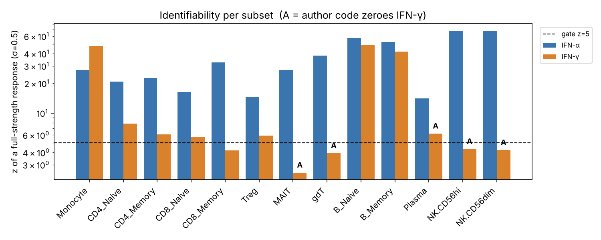
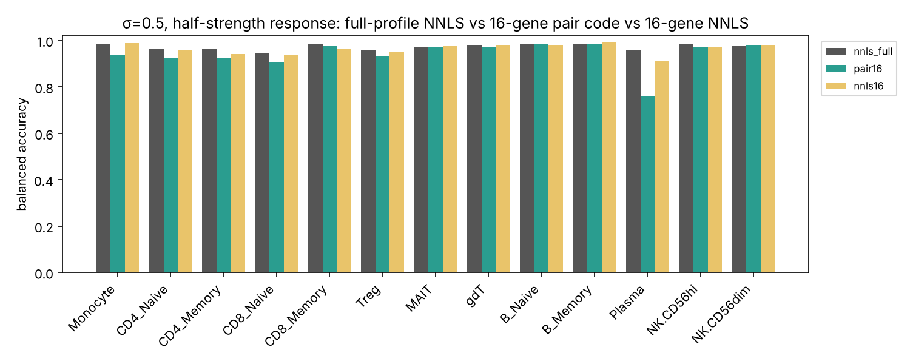
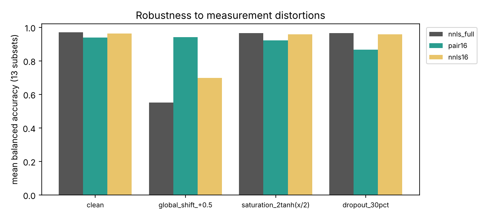
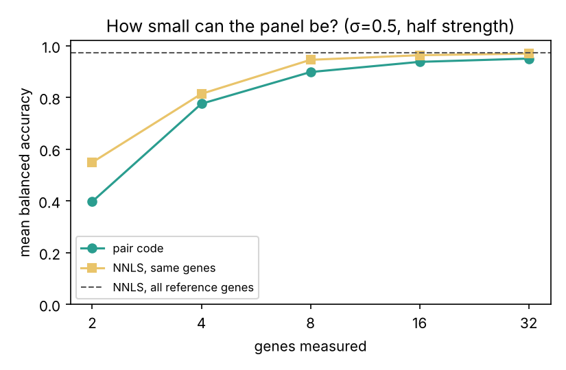

# 细胞状态库 v0.2：13 个免疫亚群 × IFN-α / IFN-γ

**结论**
- v0.2 把库改成了长表结构，启用了 13 个亚群，并为每个亚群做了可识别性检查。
- 有 5 个亚群的 IFN-γ 无法从数据里可靠识别，已撤下这部分分数，不再强行置 0。
- 基因对编码面板只测 16 个基因，在干净数据上的平衡准确率比全谱 NNLS 低约 3 个百分点（0.94 vs 0.97）。
- 当所有基因整体偏移时（例如归一化偏差），基因对编码基本不受影响（0.94），全谱 NNLS 则掉到 0.55。

所有对比都基于从同一份作者汇总参考模拟出的样本，只检验方法的稳健性，**不是生物学验证**。

---

## 1. 相比 v0.1 改了什么

| | v0.1 | v0.2 |
|---|---|---|
| 数据结构 | `reference_response(gene, ifna_log2fc, ifng_log2fc)`，宽表，只能放一种细胞、两种刺激 | `reference_profiles`（细胞类型 × 条件 × 对照）+ `reference_values`（profile × 基因），长表；加细胞、刺激、剂量、时间都是加行 |
| 细胞类型 | 仅 Monocyte | 12 个作者 L2 亚群 + Monocyte；L1 的 T/B/NK 和 PBMC 也已入库，状态为暂存 |
| 细胞层级 | 无 | `cell_types` 树（PBMC > L1 > L2）加别名表；L1/L2 Monocyte 在源数据里完全相同，只存一份 |
| 打分 | 2 参考 NNLS | K 参考 NNLS（枚举所有活跃集，精确解），2 参考时与 v0.1 逐位一致（有测试） |
| 可识别性 | 无 | 每个亚群计算 z 值、余弦、条件数，结果写入 `identifiability` 表；不可识别的刺激，查询时分数为 null |
| 面板 | 无 | 每个亚群一个 8 对基因、16 个基因的三值编码面板，写入 `pair_panels` 表 |
| 源数据 | 打包在 zip 里 | 不进 git；构建时从作者仓库固定 commit 下载并校验 sha256 |

`v_reference_wide` 视图可以还原成 v0.1 的宽表形状。

## 2. 运行

```bash
pip install numpy matplotlib            # 只有 build/benchmark 需要；query 只用标准库
python3 -m cell_state_library.build     # 下载源文件(校验 sha256) → data/cell_state_v0_2.sqlite + reports/
python3 -m cell_state_library.query target.json            # 同时输出 NNLS 和基因对编码
python3 -m cell_state_library.query target.json --method pair
python3 -m cell_state_library.benchmark # 复现第 5 节的对比和 figures/
python3 -m unittest discover -s cell_state_library/tests -t .
```

输入格式与 v0.1 相同，见 `target_query_template.json`：同一细胞类型内，目标相对匹配对照的 log2FC。未测到的基因不要填 0，直接留缺。`cell_type` 可以填作者的 L1/L2 标签，程序会自动映射。

## 3. 可识别性检查

**要回答的问题**：如果某亚群的目标样本带有一个满强度的参考响应，再加上测量噪声，这种刺激的分数能不能和 0 区分开？

**模型**：b = x_α·a + x_γ·g + e，e ~ N(0, σ²)。x 的单位是"一个完整参考响应"，SE(x) = σ·√diag((AᵀA)⁻¹)，z = 1/SE。参考响应越弱、α 与 γ 越共线，z 越小。

**门槛**：σ 默认 0.5（假设值）；z ≥ 5 且基因数 ≥ 30 才算可识别。门槛定得偏保守，因为模型把基因当作相互独立，会高估信息量。另外报告了 σ = 0.25 和 1.0 时的结果，用来看结论是否稳健。



| 亚群 | 基因数 | α/γ 余弦 | z(α) | z(γ) | σ = 0.25 / 0.5 / 1.0 | 作者代码是否把 γ 置 0 |
|---|---|---|---|---|---|---|
| Monocyte | 824 | 0.68 | 27.4 | 47.8 | 都可识别 / 都可识别 / 都可识别 | 否 |
| B_Naive | 478 | 0.63 | 57.3 | 49.2 | 都可识别 / 都可识别 / 都可识别 | 否 |
| B_Memory | 538 | 0.70 | 52.5 | 41.8 | 都可识别 / 都可识别 / 都可识别 | 否 |
| CD4_Naive | 184 | 0.93 | 20.9 | 7.8 | 都可识别 / 都可识别 / 仅α | 否 |
| CD4_Memory | 226 | 0.94 | 22.6 | 6.1 | 都可识别 / 都可识别 / 仅α | 否 |
| CD8_Naive | 173 | 0.96 | 16.3 | 5.8 | 都可识别 / 都可识别 / 仅α | 否 |
| Treg | 147 | 0.97 | 14.6 | 5.9 | 都可识别 / 都可识别 / 仅α | 否 |
| Plasma | 77 | 0.97 | 14.0 | 6.2 | 都可识别 / 都可识别 / 仅α | **是** |
| CD8_Memory | 187 | 0.87 | 32.7 | 4.2 | 都可识别 / **仅α** / 仅α | 本意是，但拼写错误导致未生效 |
| gdT | 85 | 0.78 | 38.2 | 3.9 | 都可识别 / **仅α** / 仅α | 是 |
| MAIT | 82 | 0.89 | 27.4 | 2.5 | 仅α / **仅α** / 仅α | 是 |
| NK.CD56hi | 279 | 0.34 | 68.1 | 4.3 | 都可识别 / **仅α** / 仅α | 是 |
| NK.CD56dim | 287 | 0.44 | 67.4 | 4.2 | 都可识别 / **仅α** / 仅α | 是 |

**解读**
- **稳健可分（3 个）**：Monocyte、B_Naive、B_Memory。σ = 1 时仍然可识别。
- **勉强可分（5 个）**：CD4/CD8 naive、CD4 memory、Treg、Plasma。α 与 γ 的余弦达到 0.93–0.97，IFN-γ 的响应形状几乎就是"弱一点的 IFN-α"，σ = 1 时就分不开了。
- **IFN-γ 不可识别（5 个）**：CD8_Memory、gdT、MAIT 和两类 NK。v0.2 在这些亚群里撤下 IFN-γ 分数（null），而不是像作者代码那样直接写 0，因为"0"会被误读成"没有 IFN-γ"。
- **与作者规则的对比**：数据驱动的结果与作者的"IFN-γ 无响应名单"在 4 个亚群上一致（gdT、MAIT、两类 NK）。作者名单里写的是 `Memory_CD8`，而矩阵标签是 `CD8_Memory`，所以作者代码对 CD8 记忆 T 实际**不会**置零；我们的检查恰好把它判为 IFN-γ 不可识别，与作者本意一致。唯一分歧是 Plasma：它在 σ = 0.5 时勉强过门槛（z = 6.2），但只有 77 个基因、余弦 0.97，属于边界情况。
- **使用注意**：在 IFN-γ 不可识别的亚群里，IFN-γ 暴露的样本会被 NNLS 几乎 100% 判成"IFN-α"（第 5.5 节）。所以这些细胞里的 IFNa 分数，只能理解为"有干扰素响应，类型未定"。查询输出会自动给出这条警告。

## 4. 基因对编码面板（原型）

**编码规则**：每个基因对 (i, j) 给出一个三值符号。b_i − b_j > τ 记为 `+`，< −τ 记为 `−`，其余记为 `0`（差异太小，不采信）。8 对基因就是一个 8 位三值码，存成两个位掩码，比较两个码只需一次 popcount（汉明距离）。τ = σ√2，即噪声下一个基因对差值的 1 个标准差。

**为什么这样设计**：每一位都只比较同一样本内的两个基因，所以全部基因整体平移（归一化偏差、批次偏移）时编码完全不变。它同时也是一个检测面板：8 对就是 16 个 qPCR 靶点，不需要管家基因归一化。注意它仍然需要相对匹配对照的 log2FC，因为参考数据本身就是对比值，不是原始表达量。

**判定方法**：每个类别（无响应 / IFN-α / IFN-γ）给出各符号出现的概率，强度在 0.1–3 倍参考之间取最优，然后按似然比判定。只在该亚群可识别的刺激之间做判定。

**选对方法**：贪心选择，基因不重复使用。每一对的得分是它在两个类别下符号分布的全变差距离。判断 α 与 γ 时，允许另一方取任意强度，所以选出的基因对必须是"形状不同"，而不只是"幅度不同"。目标函数是对各类别对的分离度取 log 后求和（软最小值）。

**示例面板**（括号内为参考 log2FC 差：α / γ）：
- **Monocyte**：APOBEC3A>CXCL9 (+2.1/−2.7)，CD300E>LIPA，MS4A6A>SOCS1，IFIT1>TGM2，CD14>MT-CO3，CCL8>IDO1 (+1.5/−3.6)，OTOF>SLAMF8，IFITM3>WARS。γ 一侧自动选中了经典 IFN-γ 基因 CXCL9、IDO1、SOCS1、WARS、SLAMF8。
- **B_Naive**：PLSCR1>MYD88，TNFSF13B>TAP2，APOL6>TAP1……γ 一侧以抗原加工相关的 TAP1/TAP2 为主。
- **NK.CD56dim**：IFIT1>SGSH (+11.3/+2.1)、IFI44L>GPR68……这里只有"无响应 vs α"一种判定，选出的全是 ISG 核心基因对低表达基因。

全部 13 个面板见 `reports/pair_panels.json` 或数据库 `pair_panels` 表。

## 5. 与 NNLS 的对比

**任务**：已知细胞类型，判断目标样本属于"无响应 / IFN-α / IFN-γ"。只统计该亚群可识别的类别，指标为平衡准确率，取 13 个亚群的平均。

**比较的三种方法**
- `nnls_full`：v0.1 和作者使用的 NNLS，用该亚群的全部参考基因（77–824 个）。
- `pair16`：基因对编码，8 对、16 个基因。
- `nnls16`：只用同样这 16 个基因的 NNLS（绕过 30 基因门槛），用于在相同测量预算下比较。

**公平性设置**：三种方法"有响应 vs 无响应"的阈值，都用纯噪声样本校准到 5% 假阳性率；每个类别每种配置各模拟 300 个样本，随机种子固定。

### 5.1 噪声 × 响应强度

| σ | 强度 | nnls_full | pair16 | nnls16 |
|---|---|---|---|---|
| 0.25 | 1.0 | 0.982 | 0.956 | 0.981 |
| 0.25 | 0.5 | 0.980 | 0.955 | 0.976 |
| 0.25 | 0.25 | 0.971 | 0.942 | 0.964 |
| 0.5 | 1.0 | 0.979 | 0.958 | 0.977 |
| 0.5 | 0.5 | 0.972 | 0.941 | 0.964 |
| 0.5 | 0.25 | 0.951 | 0.824 | 0.900 |
| 1.0 | 1.0 | 0.973 | 0.939 | 0.963 |
| 1.0 | 0.5 | 0.954 | 0.830 | 0.899 |
| 1.0 | 0.25 | 0.904 | 0.665 | 0.754 |



**结论**：信号够强时，16 个基因已经接近全谱。信号弱、噪声大时，全谱 NNLS 有明显优势，因为它把几百个基因的信息累加了起来。在同样 16 个基因上，三值编码比连续 NNLS 低 2–8 个百分点，这是"死区"丢掉的信息。Plasma 是最难的亚群（基因少、α/γ 共线）。

### 5.2 测量失真（σ = 0.5，半强度）

| 情形 | nnls_full | pair16 | nnls16 |
|---|---|---|---|
| 无失真 | 0.969 | 0.938 | 0.962 |
| 所有基因整体 +0.5（归一化或组成偏差） | **0.552** | **0.941** | 0.698 |
| 饱和 2·tanh(x/2)（平台动态范围上限） | 0.964 | 0.921 | 0.959 |
| 随机缺失 30% 基因 | 0.965 | 0.866 | 0.957 |



- **整体偏移**：NNLS 不做中心化（作者代码也一样，`scale(center = FALSE)`），偏移会被当成信号。例如 Monocyte 的无响应样本有 66% 被误判为 IFN-γ。基因对编码基本不受影响。预先对 NNLS 做中心化能部分缓解，但会改变作者方法的定义。
- **缺失基因**：这是小面板的弱点。缺一个基因就丢一整对，而全谱 NNLS 有大量冗余。实际做面板时，应该为每一对准备备选基因。



### 5.3 面板要多小

2 个基因不够用（0.40 / 0.55）。4 个基因约 0.78–0.81，8 个约 0.90–0.95，16 个约 0.94–0.96，32 个约 0.95–0.97，已接近全谱的 0.97。在这个任务上，**8–16 个基因是性价比的拐点**。

### 5.4 跨亚群迁移（留一亚群）

只用 13 个亚群都有的 26 个基因。面板和参考都由其余 12 个亚群的中位数得到，再拿去测被留出的那个亚群。

| | 基因对迁移 | NNLS 迁移 | NNLS 用该亚群自己的参考 |
|---|---|---|---|
| 13 亚群平均 | 0.761 | 0.817 | 0.936 |
| Monocyte | 0.33 | 0.61 | 0.98 |
| B_Naive | 0.61 | 0.69 | 0.98 |

用别的细胞的参考来打分，平均掉了 12–17 个百分点；单核和 B 细胞掉得最多，因为它们的 IFN-γ 响应与 T/NK 细胞差异很大。这在数据上说明"同一种信号在不同细胞里效果不同"：**参考必须按细胞类型分开建**，不能用一套通用参考覆盖所有细胞。基因对编码的迁移性也不比 NNLS 好。

### 5.5 IFN-γ 不可识别亚群里的 IFN-γ 样本（σ = 0.5，满强度）

| 亚群 | NNLS 判为 IFN-α | 基因对判为 IFN-α / 无响应 |
|---|---|---|
| CD8_Memory | 100% | 96% / 4% |
| MAIT | 100% | 82% / 18% |
| gdT | 100% | 94% / 6% |
| NK.CD56hi | 99% | 29% / 71% |
| NK.CD56dim | 99% | 24% / 76% |

这些亚群受 IFN-γ 刺激后产生的弱响应，在形状上和"弱 IFN-α"几乎一样，两种方法都无法分辨。这验证了第 3 节撤下 IFN-γ 分数的做法是必要的。

## 6. 解读边界与已知局限

- **不是生物学验证**。所有测试样本都由作者的汇总参考加独立高斯噪声生成，测试与参考来自同一来源。没有独立供体，也没有独立研究。真实噪声的大小和基因间相关性都未知（σ 是假设值）。
- **设计改动是在看到结果后做的**。基因对方法有两处改动：强度网格从 0.25–2 扩大到 0.1–3，筛选目标从硬最小值改成 log 软最小值。起因是第一版出现了随信号增强准确率反而下降的异常，查明是网格边界造成的假象（高度共线时，"弱 α"在网格边缘恰好能冒充"γ"）。改动解决的是查明的问题，并非针对分数调参；但由于测试与参考同源，这一点仍需如实说明。
- **系数含义**：系数和似然比都不是概率、浓度或配方，基因对编码的似然也不是经过校准的概率。
- **基因范围**：只覆盖作者按响应挑选的 IFN 相关基因，不代表完整细胞状态。各亚群的基因列表是在该亚群里按显著性选出的，本身带有选择偏倚。
- **背景信息**：Plasma 的培养背景（B 细胞富集）是按谱系推断的，有待核实。其他亚群是在 T、B、NK 富集培养后，通过单细胞聚类注释得到的。
- **剂量与时间**：方法页给出 IFN-α2a 1000 U/mL、IFN-γ 25 ng/mL、21 h、5 名供体，未写明各亚群是否完全一致，库中按同一条件记录。
- **面板可检测性**：面板没有考虑可检测性（表达丰度、引物、蛋白水平），这是下一步。线粒体基因（如 MT-CO3）是否适合做靶点，需要结合平台判断。

## 7. 下一步

1. **取得供体级数据**（作者 HISE 入口需要登录）：用实测噪声替换假设的 σ，做留一供体验证。这是把模拟对比变成真实验证的关键一步。
2. **接入 Parse 10M**：90 种细胞因子 × 12 名供体，直接作为新 profile 加入同一套长表，检验长表和 K 参考 NNLS 能否扩展到多刺激。
3. **补上面板的可检测性筛选**：加入表达丰度和表面/分泌蛋白注释，给每个基因对准备备选基因，以应对缺失。
4. **自有实验**：v0.1 规划的 15 个样本（5 名供体 × 未刺激 / α / γ）仍保留在 `planned_experiments` 表，状态为未执行。

## 8. 文件

| 路径 | 内容 |
|---|---|
| `schema.sql` | 长表结构 |
| `build.py` | 下载校验 → 建库 → 可识别性检查 → 选面板 → 自检 |
| `nnls.py` | K 参考 NNLS（标准库） |
| `identifiability.py` | 可识别性检查 |
| `pair_code.py` | 基因对编码与打分（标准库） |
| `panel_select.py` | 面板筛选（numpy） |
| `query.py` | 查询 CLI（标准库） |
| `benchmark.py` | 第 5 节的对比与作图 |
| `tests/` | 16 个软件测试，包括与 v0.1 逐位一致的回归测试 |
| `reports/` | manifest、validation、identifiability、pair_panels、benchmark（JSON） |
| `figures/` | 4 张图 |
| `*_template.json`, `expansion_catalog.json` | 查询模板、自有样本录入模板、扩展目录 |
| `data/`（不进 git） | 源 CSV 与 SQLite |

## 9. 来源

- 作者仓库：https://github.com/aifimmunology/IFN_manuscript ，commit `3f4b1874`，文件 `Inputs/IFNa_IFNg_Scoring_ISGs_Mat.csv`，sha256 `813fa4aa…ba584`
- 实验方法：https://apps.allenimmunology.org/aifi/resources/ifn-response/methods/
- 分析方法：https://apps.allenimmunology.org/aifi/resources/ifn-response/analysis/ （MAST、5 名供体中位数 log2FC、NNLS 打分）
- 论文：Kuan, Moss, Sakai et al., *Dissecting type I and II interferon impacts on human immune cells in disease by a cell type-specific interferon response atlas*, Research Square preprint, 2025
- 作者仓库未找到明确的许可证文件。因此源数据和构建出的数据库都不提交到 git，商业再分发前需要先确认使用条款。
