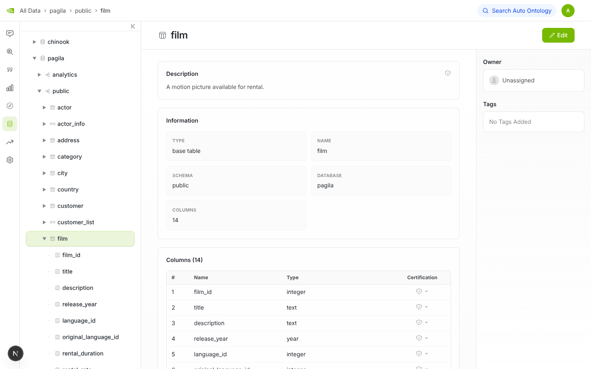
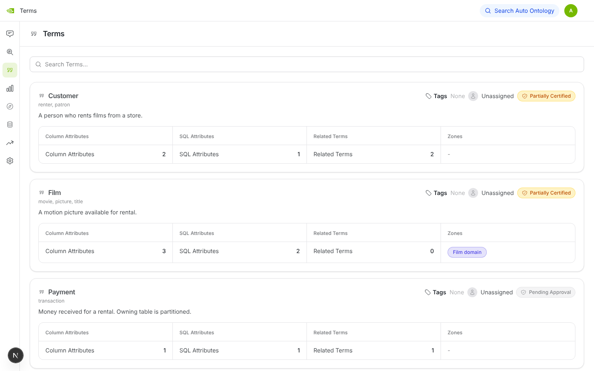
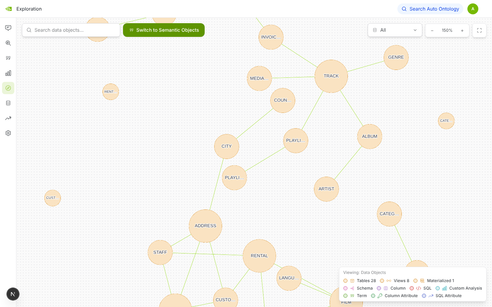
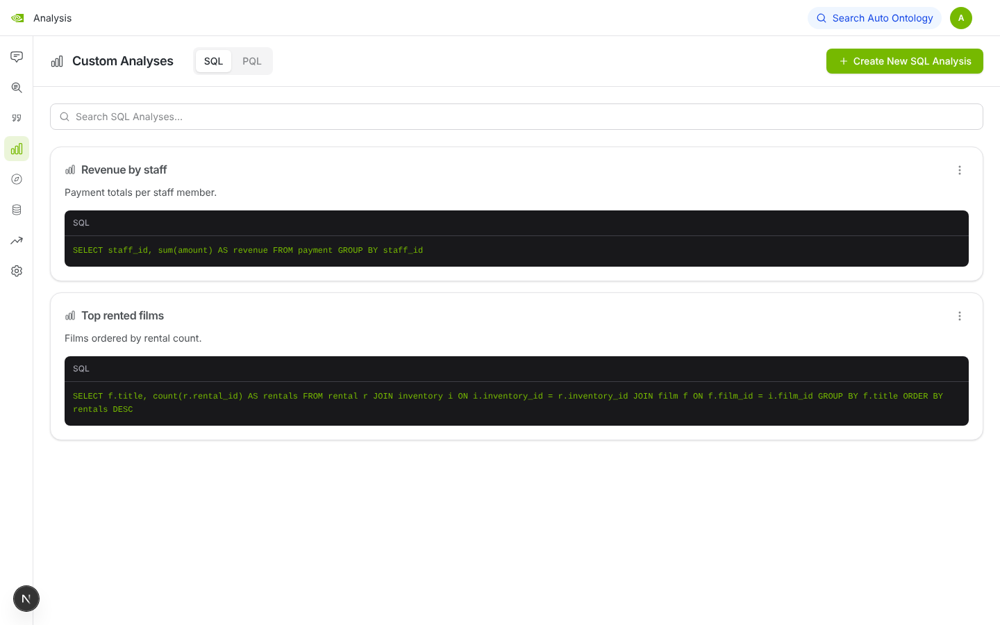

# NVIDIA Auto Ontology 安装与演示

[NVIDIA/auto-ontology](https://github.com/NVIDIA/auto-ontology) 是一个给 AI Agent 用的
“语义层”：它从数据库元数据自动生成**本体**（业务术语、同义词、术语之间的关系、标准指标口径），
然后通过 MCP / API / CLI 提供给 Agent，让 Agent 写 SQL 时知道“数据在哪、是什么意思、该怎么算”，
并且能校验 Agent 生成的 SQL。

这个目录在**没有 Docker、没有 NVIDIA API key** 的 Linux 环境里把它装起来，
用两个示例库（pagila：DVD 租赁；chinook：音乐商店）做了演示。

## 快速开始

```bash
bash setup.sh        # 装 Postgres16 + pgvector、Python/前端依赖、灌示例数据、启动前后端
python3 demo.py      # 命令行演示（输出样例见 demo_output.txt）
```

- 界面：http://localhost:3000 （`admin@example.com` / `demo-password-123`）
- API 文档：http://localhost:3001/docs

## 演示内容（`demo.py`）

| 步骤 | 演示了什么 | 需要 LLM？ |
|---|---|---|
| 1 数据目录 | 自动抽取的库 / schema / 表 / 列 | 否 |
| 2 本体 | 术语 `Customer / Film / Payment / Rental / Track`，带同义词和认证状态 | 否（本演示为手写，正式流程由 LLM 编译生成） |
| 3 语义关系 | `Payment → Customer`、`Rental → Customer` | 否（同上） |
| 4 同义词检索 | “movie”→Film，“song”→Track，“renter”→Customer | 否 |
| 5 标准指标 | 挂在术语上的 SQL 口径（总收入、每类影片数…），直接在源库执行出结果 | 否 |
| 6 护栏 | 校验 Agent 生成的 SQL：合法通过；引用不存在的表 `films` 被拒；重复口径被拒 | 否 |
| 7 自定义分析 | 保存的分析（按员工统计收入、最常租的影片）并执行 | 否 |
| 8 导出模型 | 整个本体导出为 YAML（`exported_model.yaml`） | 否 |
| 9 自然语言问答 | “Which film category has the most films?” → SQL → 答案 | **是**（无 key 时会报 401） |

注：校验只检查 SQL 引用的**表**是否在目录里，不检查列名（例如 `SELECT revenue FROM film` 会通过）。

## 截图

| 数据目录：表详情 | 业务术语 |
|---|---|
|  |  |
| **数据对象关系图（两个库的外键）** | **自定义分析** |
|  |  |

## 打开自然语言问答

1. 到 <https://build.nvidia.com> 免费申请一个 `nvapi-...` key。
2. 在 `setup.sh` 生成的 `.env` 里加上 `DEFAULT_MODELS_API_KEY=nvapi-...`（或运行前
   `export DEFAULT_MODELS_API_KEY=...`），重启后端。
3. 示例数据灌入时跳过了向量嵌入，问答检索不到候选，所以要重建一次语义层：
   - 启动摄入服务（:3002）：`uv run --no-sync python -m auto_ontology.ingestion_service`
   - 在 UI 的 **Settings → Semantic Compilation** 里重建（即 `POST /api/semantic-compilation/reset`）。
     它会删掉手写的演示术语，用 LLM 逐表重新生成术语、关系并写入向量索引。

   这一段没有在本环境验证过（没有 key），以上游文档为准。

## 安装中遇到并绕过的问题

- **没有 Docker**：官方推荐 Docker Compose / Helm。这里直接用系统 PostgreSQL 16，
  后端用 `uv`、前端用 `pnpm` 在本机运行。
- **pgvector 太旧**：Ubuntu 的 `postgresql-16-pgvector` 是 0.6，缺少 `halfvec` 类型；
  `setup.sh` 从源码编译 0.8.1。
- **pagila.sql 是 PG17 导出的**：含 `SET transaction_timeout`，PG16 不认识；`setup.sh` 把这一行注释掉。

## 验证

上游测试：`uv run pytest auto_ontology dev_tools -q` → **2529 通过**，18 个失败全部是可选的
Kumo 预测插件（`kumo-relational-client` 未安装，需要 `uv sync --extra kumo` 和 Kumo 账号）。
