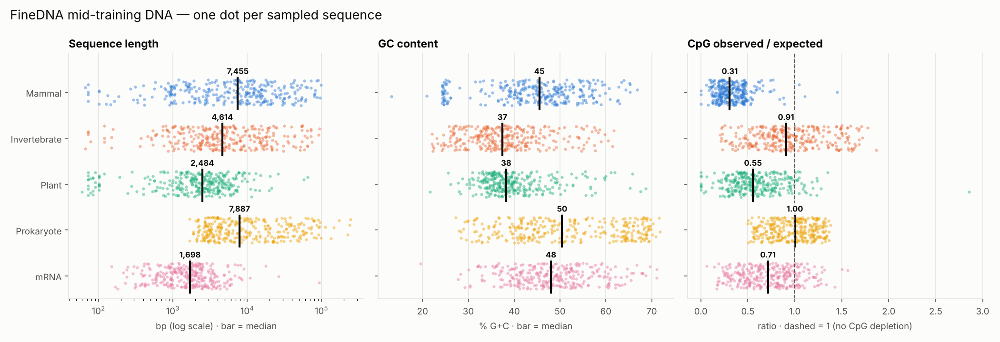
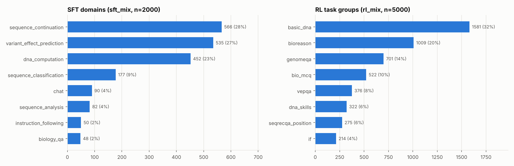

# FineDNA demo

[`HuggingFaceBio/FineDNA`](https://huggingface.co/datasets/HuggingFaceBio/FineDNA) 是 Carbon-X（把 Qwen3-14B
训练成能"读 DNA"的模型）三个训练阶段的全部数据：

| 阶段 | 配置 | 规模 |
|---|---|---|
| Mid-training | `mid_*`，23 个来源（基因组、mRNA、含 DNA 的生物文献、英文网页、指令数据） | 514B tokens，约 950 GB |
| SFT | `sft_mix` + 8 个领域子集 | 203,923 条对话 |
| RL | `rl_mix` | 98,433 条可用代码判分的题 |

数据集约 1 TB，不能全量下载。这个 demo 用 `datasets` 的**流式读取**，每个配置只拉几百到几千行
（总共约 150 MB 网络读取，2–3 分钟），然后做三件事。

## 运行

```bash
pip install -r finedna_demo/requirements.txt
```

```bash
python finedna_demo/finedna_demo.py
```

```bash
python finedna_demo/finedna_demo.py --n-dna 100 --n-sft 500 --n-rl 2000   # 更快的小样本
```

抽到的行缓存在 `finedna_demo/cache/`（不入库），重跑只重做分析。

## 1. 预训练 DNA：组成是否符合生物学常识

5 个 DNA 配置各抽 300 条（流式 + 1000 行洗牌缓冲）：



| 组 | 序列长度中位数 | GC% 中位数 | CpG 观测/期望 | 长度为 6 的倍数 | 带物种/基因类型标签 |
|---|---:|---:|---:|---:|---:|
| 哺乳动物 | 7,455 bp | 45.5 | **0.31** | 100% | 48% |
| 无脊椎动物 | 4,614 bp | 37.4 | 0.91 | 100% | 50% |
| 植物 | 2,484 bp | 38.3 | 0.56 | 100% | 47% |
| 原核生物 | 7,887 bp | 50.4 | **1.00** | 100% | 0% |
| mRNA | 1,698 bp | 48.0 | 0.71 | 100% | 0% |

- **CpG 缺失梯度**符合预期：哺乳动物 DNA 甲基化导致 CpG 强烈缺失（≈0.3），植物居中，
  很多无脊椎动物（如昆虫）几乎不甲基化（≈0.9），细菌没有缺失（≈1.0）。这说明数据是真实基因组序列，没有被打乱。
- 原核生物 GC% 呈双峰（约 35% 和 65%），反映不同菌种的基因组 GC 差异。
- README 的格式声明都对得上：所有序列长度都是 6 的倍数（模型按不重叠的 6-mer 分词），
  真核序列约一半带标签，如 `<mammalian_species><protein_coding_region><dna>ATG…</dna>`。

分词示例（`summary.json` → `tokenization_example`）：
`ATTTTTTTTTAGACAG…` → `ATTTTT | TTTTAG | ACAGAA | …`

## 2. SFT / RL 的任务构成



SFT 以序列续写、变异致病性判断、DNA 计算三类为主（共约 78%）。每个领域的一条完整对话样例在
[`results/sft_examples.md`](results/sft_examples.md)。

## 3. 独立复核 RL 标准答案

`rl_mix` 中 `basic_dna` 组的题都是可算出确定答案的小题（GC 含量、反向互补、酶切片段数、翻译、
Cas9 切点、Tm 值……共 60 多种）。[`verifiers.py`](verifiers.py) 用纯 Python 为其中 24 种题型重写了
求解器，从题面解析序列、自己算答案，再和数据集给的 `answer_text` 比对：

| 抽样 5,000 行 RL 数据 | 行数 |
|---|---:|
| `basic_dna` 题 | 1,581 |
| 有我们求解器的题型 | 720 |
| 与标准答案一致 | **717（100%）** |
| 不一致 | 0 |
| 题面措辞没解析出来 | 3 |

逐条结果在 [`results/rl_check_details.csv`](results/rl_check_details.csv)。这些求解器也可以直接当作 RL
的奖励函数使用。

## 局限

- 这是抽样，不是全量统计。真核配置的 300 条只来自 25–41 个不同的基因组 contig（流式读取集中在一个分片），
  表中数字是示意性的，不代表整个配置的分布。
- 只看了数据，没有加载 Carbon-X 模型做推理（14B 参数需要 GPU）。
- 数据集 Apache-2.0；mid-training 部分来自第三方来源，各有自己的许可。
