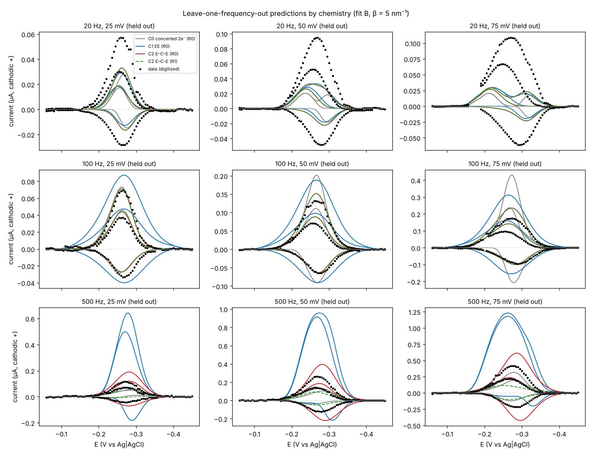
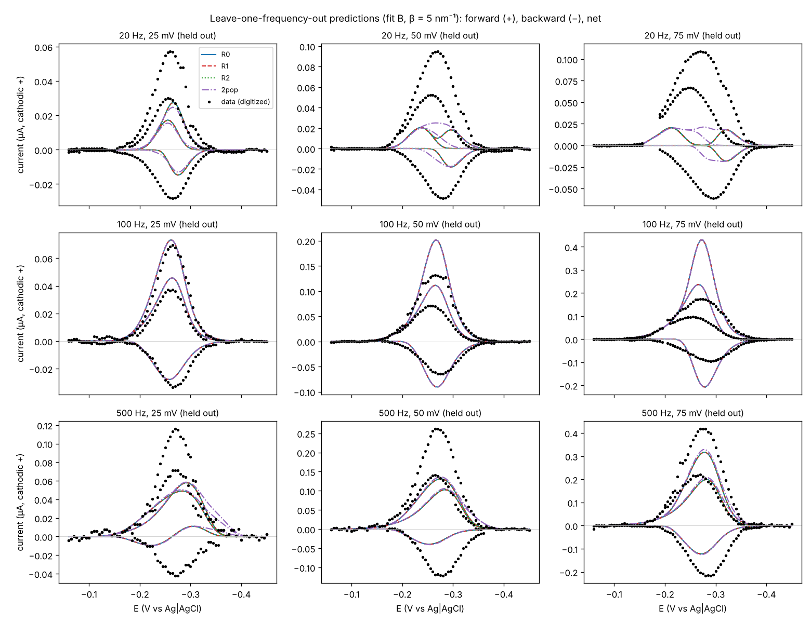
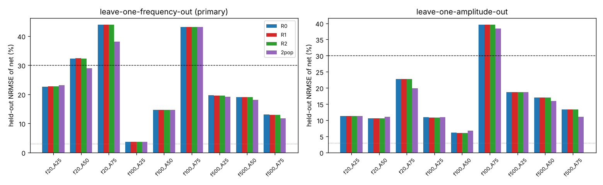
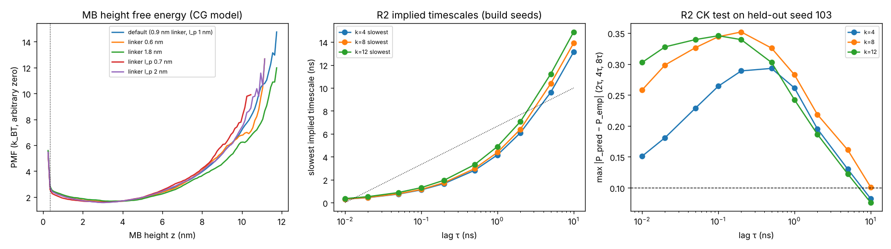

# Conformational dynamics in pulsed electron transfer — three-route comparison (MB–DNA, SWV)

**Question.** With the same data and the same electron-transfer assumption, does keeping conformational
exchange (R1, R2) predict square-wave current better than a static / fast-equilibrium average (R0)?

This round implements a real dynamic current backend: the joint conformation × redox master equation is
propagated through the exact SWV waveform, and current comes only from redox jumps. Contact probability
is never used as a current. Pre-registered protocol: [`PROTOCOL.md`](PROTOCOL.md), frozen in commit
`c05c2a4` before any fitting. Data provenance and digitization: [`data/dauphin2017/MANIFEST.md`](data/dauphin2017/MANIFEST.md).

## 第二轮：加入 MB 分步电子／质子化学后再比较（预注册见 `PROTOCOL.md` Round 2 addendum）

**结论：换成分步化学后，化学模型本身显著改善了拟合与振幅留出预测，但保留构象转换仍然没有带来可归因于动力学的预测增益。** 预注册指标表面上显示 R1/R2 在 C1、C2 下比 R0 好 13–67 %，但逐折分解证明这些差异来自优化盆地（R0 的 4 个初值落在外推较差的等价训练解上），不是构象动力学。

化学模型（每种化学下都跑 R0/R1/R2/静态双群体对照，数据、折、目标函数、指标与第一轮相同）：

| 化学 | 机理 | 参数（含 Q） |
|---|---|---|
| C0 | 协同表观 2e⁻ Butler–Volmer（第一轮） | 4 |
| C1 EE | O + e⁻ ⇌ I ⇌(+e⁻) R，两步 1e⁻ BV，质子化快速并入表观电位 | 6 |
| C2 E–C–E | O + e⁻ ⇌ I；I + H⁺ ⇌ IH（有限速率 k_p，K_p = 10 固定，1/100 为敏感性）；IH + e⁻ ⇌ R | 7 |

两步电子转移都乘同一距离因子 w(z)，质子化不随距离变化；联合链（构象 × 红氧物种）对 π⊗q(E) 满足细致平衡，因此第一轮的精确对称平方根/SVD 传播器可直接推广（`chem_backend.py`；`tests/test_chem.py` 与第一轮后端、稠密 expm、Radau 刚性积分、快/慢交换极限、可逆极限和两波分离极限一致）。

**1. 化学的作用（R0 路线，Fit B；括号为同折最佳训练盆地 R0\*，事后诊断）**

| 化学 | 全数据训练代价 | 留一频率 NRMSE_net | 达标（频率） | 留一振幅 NRMSE_net | 达标（振幅） |
|---|---|---|---|---|---|
| C0 | 0.0245 | 23.6 % | 2/9 | 16.7 % | 4/9 |
| C1 EE | 0.0094 | 61.6 %（R0\* 57.0 %；500 Hz 留出不可识别，近最优解 17–126 %） | 1/9 | 9.0 % | 8/9 |
| C2 E–C–E | 0.0049 | 19.6 %（R0\* 17.0 %） | 2/9 | 10.6 %（R0\* 6.9 %） | 8/9 |
| C2，K_p = 1 / 100 | 0.0047 / 0.0052 | 24.1 % / 25.3 % | 2/9 / 1/9 | — | — |

- 分步化学使训练误差降低 2.6–5 倍；**振幅留出**从 16.7 % 降到 7–11 %，达标曲线从 4/9 升到 8/9。
- **频率外推仍未解决**：所有化学下留出 20 Hz 时峰值仍低估 43–73 %（C2 对 100 Hz 留出很好，2.7–13 %）；C1 对 500 Hz 留出完全不可识别（训练代价相差 < 5 % 的 7 个解，留出误差 17 %–126 %）。
- C2 参数在各频率折间稳定、化学上可解释：有效速率 k₁⟨w⟩ ≈ 70–280 s⁻¹、k₂⟨w⟩ ≈ 360 s⁻¹，电位反转 ΔE = E₁ − E₂′ ≈ −0.13 至 −0.17 V（半醌不稳定，第二个电子更易转移），质子化 k_p ≈ 600–1700 s⁻¹，与 SWV 时间尺度相当——这是频率依赖波形的一个可信来源。但 K_p 未被数据确定（1/10/100 留出误差 24/20/25 %），因此 C2 只是"可拟合且对振幅外推较好"的候选机理，**不是被验证的机理**（9 条回顾性曲线、推测单电极）。

**2. 三路线比较（每种化学内部）**

| 化学 | 折 | R0 拟合 | R0\*（事后最佳盆地） | R1 | R2（条件） | 静态双群体 |
|---|---|---|---|---|---|---|
| C1 | 留一频率 | 61.6 % | 57.0 % | 20.5 % | 20.8 % | 39.3 % |
| C1 | 留一振幅 | 9.0 % | 9.1 % | 9.1 % | 9.1 % | 8.5 % |
| C2 | 留一频率 | 19.6 % | 17.0 % | 17.0 % | 19.2 % | 15.6 % |
| C2 | 留一振幅 | 10.6 % | 6.9 % | 7.4 % | 8.3 % | 6.1 % |

增益分解（`decompose_gain.py`，`results/chem_gain_decomposition.json`）：对每个 R1/R2 解，把**同一化学参数点**放回 R0（去掉动力学）以及同路线 s = 1 重算。在 24 个 R1/R2 留出折中，"R0@同参数" 与 R1/R2 的训练代价和留出误差几乎在所有折相同——例如 C1 留出 500 Hz：R0 自身拟合与 R1 训练代价同为 0.0047，留出误差却是 125.7 % vs 17.0 %，R0 放到 R1 的参数点上即得 17.0 %。真正由构象动力学造成的差异只出现在 s 撞到下界 10⁻³（运动比 Stokes–Einstein 慢 1000 倍）的少数折，且方向不一致（C2-R1 留 50 mV：7.7 % → 4.2 %；C2-R2 留 25 mV：6.7 % → 9.8 %）。Fit A（共享 θ、s = 1）下三路线逐曲线相同（≤0.1 %）。因此：**不宣称动力学增益**；预注册的"≥10 % 降低"在表面数字上被满足，但经分解不可归因于构象动力学，记为优化盆地差异。

静态双群体对照在 C2 下最好（留一频率 15.6 %、5/9 达标；留一振幅 6.1 %），相对 R0\* 改善 8–12 %，且去掉异质性（δ = 0）会显著恶化训练代价——速率异质性（而非构象运动快慢）被数据实际使用，但仍只多一个参数、只有 9 条曲线，不宣称机制成立。

R1 网格检查（20 格拟合，在每个最优点用 40/80 格重算）：曲线最大差 1.9 % / 3.6 %（出现在 s 下界的解），所有折留出 NRMSE 变化 ≤0.1 %。第二轮计算约 4.5 CPU·h；累计约 16 CPU·h，低于 24 h 上限。



全部表格：[`results/tables_chem.md`](results/tables_chem.md)；不可识别性与双群体诊断：`identifiability_chem.py`、`results/chem_identifiability.json`（事后诊断，非预注册）。

---

## 第一轮结论（协同 2e⁻ 化学）

**在同一数据、同一表观双电子 Butler–Volmer 假设下，保留构象转换（R1、R2）没有比静态／快平衡平均（R0）更准确地预测 SWV 电流。** 三条路线的留出 NRMSE 在所有折、Fit A/B、β = 2/5/10 nm⁻¹ 下相差 ≤0.1 %（数字化噪声地板约 3 %），远低于预设的 10 % 动力学增益门槛。这是一个有效的阴性结论，原因可直接定量：

- 本柔性粗粒化模型中 MB 高度的最慢弛豫约 5 ns（R1，40/80 格一致）至 15 ns（R2 隐含时间尺度），而半脉冲长 1–25 ms，相差 ~10⁵–10⁶ 倍；
- 拟合给出的有效速率 k_eff = k_c⟨e^{−β(z−z_min)}⟩ ≈ 10^2.44 × 0.022 ≈ 6 s⁻¹，接触层的局部交换速率 ~10⁹–10¹⁰ s⁻¹（s = 10⁻³ 时仍 ~10⁷ s⁻¹），没有任何"接触层耗尽"能被 SWV 看见；
- 全局运动倍率 s 的剖面在 10⁻¹–10³ 完全平坦（代价不变到 5 位有效数字），在 10⁻³ 边界只降 0.15 %：**数据不含构象运动快慢的信息**。R1/R2 的拟合把 s 推到下界（已标注触边），但收益可忽略。

**三条路线共同失败的地方与构象无关。** 主评价（留一频率）平均 NRMSE_net 23.6 %，但只有 2/9 条留出曲线同时满足 NRMSE ≤30 % 且峰误差 ≤30 %；次评价（留一振幅）16.7 %，4/9 达标。留出 20 Hz 时峰值低估 52–81 %，100 Hz/75 mV 高估 148 %。后端在教科书极限下行为正确（慢动力学→反向电流为阴极、k/f≈1→反向为阳极、快极限→电流消失；见 `tests/`），所以这是**单速率 BV 化学模型本身**无法同时解释 500 Hz 的强阳极反向电流（要求 k ~ 10²–10³ s⁻¹）和 20 Hz 仍很大的电流（同一 k 下应几乎为零）。等参数 5 参数静态双群体对照只改善 4–5 %（亦低于 10 %），且参数在各折间极不稳定（δ 从 0.7 到上界 9.2，常仅 1/6 个初值收敛到最优），不可识别。残差不归因于构象动力学；MB 分步电子/质子反应、更宽的速率异质性或电极/仪器非理想性都是候选，本轮未建模。

### 状态标签（分开标记）

| 标签 | 状态 |
|---|---|
| 数值正确 | ✅ 6+1 项测试：全系统 expm、整段扫描 Radau 刚性积分、快/慢交换极限、生成矩阵非负/细致平衡、Nernst 保持、已知 CTMC 速率恢复；R1 40 vs 80 格曲线差 ≤0.05 % |
| 分子模型平衡量内部合格 | ✅ 时间步 0.5 ps（减半变化 ≤3.9 %）；4 种子 × 2 半程块 PMF 差 ≤0.22 k_BT；各种子态权重差 ≤0.01；接触占有率 0.018–0.022 |
| 分子模型内部动力学合格（R2） | ❌ k = 4/8/12、τ = 10 ps–10 ns 全部未通过隐含时间尺度与 CK 门槛（隐含时间尺度随 τ 持续上升，无平台）；R2 **无正式排名资格**，仅作"给定未验证动力学的条件电流预测" |
| 时间经实验校准 | ❌ s 不可识别（剖面平坦），CG 布朗时间未被电化学数据校准 |
| 留出预测达标 | ❌ 主评价 2/9、次评价 4/9 条曲线达标（所有路线相同） |
| 目标体系转移（TBA／NPY） | 未执行（见下文"未完成项"） |

### 主评价：留一频率，Fit B（各路线校准），β = 5 nm⁻¹

| 留出曲线 | R0 NRMSE_net（峰误差） | R1 | R2（条件） | 双群体对照 |
|---|---|---|---|---|
| 20 Hz / 25 mV | 22.7 % (−52 %) | 22.7 % (−52 %) | 22.7 % (−52 %) | 23.2 % (−57 %) |
| 20 Hz / 50 mV | 32.3 % (−79 %) | 32.4 % (−79 %) | 32.3 % (−79 %) | 29.0 % (−74 %) |
| 20 Hz / 75 mV | 43.9 % (−81 %) | 43.9 % (−81 %) | 43.9 % (−81 %) | 38.1 % (−81 %) |
| 100 Hz / 25 mV | 3.7 % (+5 %) | 3.7 % (+5 %) | 3.7 % (+5 %) | 3.7 % (+5 %) |
| 100 Hz / 50 mV | 14.6 % (+54 %) | 14.7 % (+54 %) | 14.7 % (+54 %) | 14.7 % (+54 %) |
| 100 Hz / 75 mV | 43.1 % (+148 %) | 43.1 % (+148 %) | 43.1 % (+148 %) | 43.1 % (+148 %) |
| 500 Hz / 25 mV | 19.6 % (−58 %) | 19.6 % (−58 %) | 19.6 % (−58 %) | 19.1 % (−57 %) |
| 500 Hz / 50 mV | 19.0 % (−50 %) | 19.0 % (−50 %) | 19.0 % (−50 %) | 18.2 % (−48 %) |
| 500 Hz / 75 mV | 13.0 % (−24 %) | 13.0 % (−24 %) | 13.0 % (−24 %) | 11.8 % (−21 %) |
| **等权平均** | **23.6 %** | **23.6 %** | **23.6 %** | **22.3 %** |
| 相对 R0 | — | +0.1 % | +0.1 % | −5.3 % |
| 达标曲线数 | 2/9 | 2/9 | 2/9 | 2/9 |

次评价（留一振幅）：R0/R1/R2 均 16.7 %，双群体 16.0 %（−4.0 %），均 4/9 达标。Fit A（共享 θ、s = 1）两种折法下三路线逐曲线一致到 0.1 %。β = 2、10 nm⁻¹ 只改变 k_c 的解释，不改变任何留出指标（差 ≤0.1 %）。全部表格：[`results/tables_dt0.5.md`](results/tables_dt0.5.md)；原始结果：`results/cv_results_dt0.5.json`。





### 参数与可识别性（全数据 Fit B）

- R0：log₁₀k_c = 2.44（k_eff ≈ 6 s⁻¹），α = 0.35，E⁰ = −0.257 V vs Ag/AgCl，Q = 4.8 nC（≈ Γ 8×10⁻¹³ mol cm⁻²，按 0.03 cm²）；5/6 初值收敛到同一最优；k_c 剖面清晰（±0.5 decade 代价升 ~50 %）。
- R0 中 β 与 k_c 不可分，只解释有效速率；R1/R2 的 k_c 与 R0 相同到 0.01 decade。
- 文献历史参考（不同模型，不排名）：作者 COMSOL 薄层模型 k⁰ = 0.4 ± 0.1 cm s⁻¹、α = 0.37 ± 0.02。我们的 α = 0.35 与之接近；k 的单位体系不同，不做换算比较。
- 连接臂几何单因素敏感性（0.6/1.8 nm、l_p 0.7/2 nm）：⟨w⟩ 0.020–0.026、R1 弛豫 5.1–5.9 ns；不改变"构象混合远快于半脉冲"的结论，只按比例改变推断的接触速率 k_c。

## 数据层状态

| 层 | 状态 |
|---|---|
| 2017 DNA20–MB SWV（主基准） | 已使用。9 条曲线来自 SI 图 S-7 实验线读图（保留原图、坐标映射、读数误差；作者拟合圆点被剔除）；回顾性、已见数据，100 Hz 曲线不称为新验证；9 条条件曲线推测来自同一电极，非 9 个独立电极，无统计显著性主张 |
| 2018 链动力学（外部动力学检查） | **数据不足**。Dauphin-Ducharme 等，J. Phys. Chem. C 2018, 122, 21441（doi:10.1021/acs.jpcc.8b06111）主文闭源；免费 SI 只有 12 个末端 MB 构建体（3–60 nt）与 11 个内部标记构建体的序列，无速率数值；摘要只给出 5–400 s⁻¹、短链平台、约 N^−2.2 幂律。未提取到任何可核查的实验速率，未做拟合或留出检验 |
| 2021 MB–DNA CV（化学应力检查） | 本轮未执行（首轮记录的数据清单不在本仓库，未重新获取） |
| TBA／NPY 转移层 | 本轮未执行。首轮冻结的浓度、TL→IL 拆分、覆盖度与波形参数限制不在本仓库/分支中，无法"沿用"；未构造任何 holo 结构或剂量拟合 |

## 偏离预注册方案（全部在拟合前或与电流数据无关的步骤中做出）

1. 排斥体积与排斥平面由 WCA 改为截断谐振排斥（1000 k_BT nm⁻²，接触距离不变）：WCA 作用于 0.15 nm 连接臂珠时，所有允许时间步（≥0.1 ps）显式布朗积分不稳定。连接臂/C6 珠半径 0.15 nm 为本轮假设。
2. 每个 OpenMM context 内放 64 个互不作用的独立副本；"种子" = 一个 context。单副本吞吐（~1.5 万步/s）无法把时间步检验的统计误差压到 5 % 以下。
3. R2 候选滞后增加 5、10 ns（最慢弛豫 ~20 ns）；CK"与独立轨迹不确定性相容"操作化为偏差 ≤3 SE 或 ≤0.03。
4. 缓冲液未在原文中说明，假设水黏度 0.89 mPa s、298.15 K。
5. 拟合目标同时包含正向/反向/差分三分量（各按观测峰谷幅度归一），主指标为差分 NRMSE。

## 计算记录

约 11 CPU·h（4 核约 4 h 墙钟）：MD 约 7.5 CPU·h（含被后台时限中断而重跑的一批），R2 构建约 1 CPU·h，拟合与交叉验证约 2.2 CPU·h。远低于 24 h 上限；无新增付费资源。

## Pipeline

| step | file | what it does |
|---|---|---|
| data | `digitize_2017.py` | reads the experimental lines (not the fit circles) of SI Fig. S-7, per-panel axis calibration, reading errors, overlay audit |
| backend | `swv_backend.py` | exact half-pulse propagation of the deviation from Nernst equilibrium; spectrum from an SVD of the generator's square-root factor (stable when exchange is 10⁸–10¹³× faster than ET); R0, R1, generic reversible generators, two-population control |
| tests | `tests/test_backend.py` | vs full-system `expm`, vs stiff Radau integration over a whole scan, fast/slow exchange limits, generator properties, Nernst hold, CTMC generator recovery |
| molecule | `cg_md.py`, `md_campaign.py` | OpenMM CPU Brownian dynamics, 1 bead/nt, 64 independent replicas per context, 4 seeds, mixed extended/collapsed starts |
| time step | `md_analysis.py` | selection rule: fastest dt whose halving changes ⟨z⟩, ⟨R_g⟩, P(contact), ⟨e^{−β(z−z_min)}⟩, contacts and τ_z by ≤5 % |
| R2 | `msm.py`, `r2_build.py` | k-means states on (z, R_g, r_end, contacts), reversible generator by lag-τ likelihood, timescale / CK / sampling / block-PMF gates |
| fits | `fit_cv.py`, `run_analysis.py` | fit A (shared θ) and fit B (per-route + global s), frequency and amplitude folds, β and grid sensitivity, profiles |
| report | `summarize.py` | tables (`results/tables_dt*.md`) and figures (`figures/`) |
| round 2 chemistry | `chem_backend.py`, `tests/test_chem.py` | C0/C1 EE/C2 E–C–E on conformation × redox species, same exact propagator |
| round 2 fits | `run_chem.py`, `summarize_chem.py` | per-chemistry routes, folds, fit A/B, K_p sensitivity, 20/40/80-cell checks |
| round 2 diagnostics | `decompose_gain.py`, `identifiability_chem.py` | dynamics-vs-optimum decomposition; near-optimal held-out spread (post hoc) |

Reproduce (about 2–3 h on 4 cores):
```
python mb_dynamics/digitize_2017.py
python -m pytest mb_dynamics/tests -q
cd mb_dynamics && python md_campaign.py dt --dts 1.0,0.5,0.25 && python md_analysis.py
python r2_build.py <dt> && python run_analysis.py --dt <dt> && python summarize.py <dt>
```
