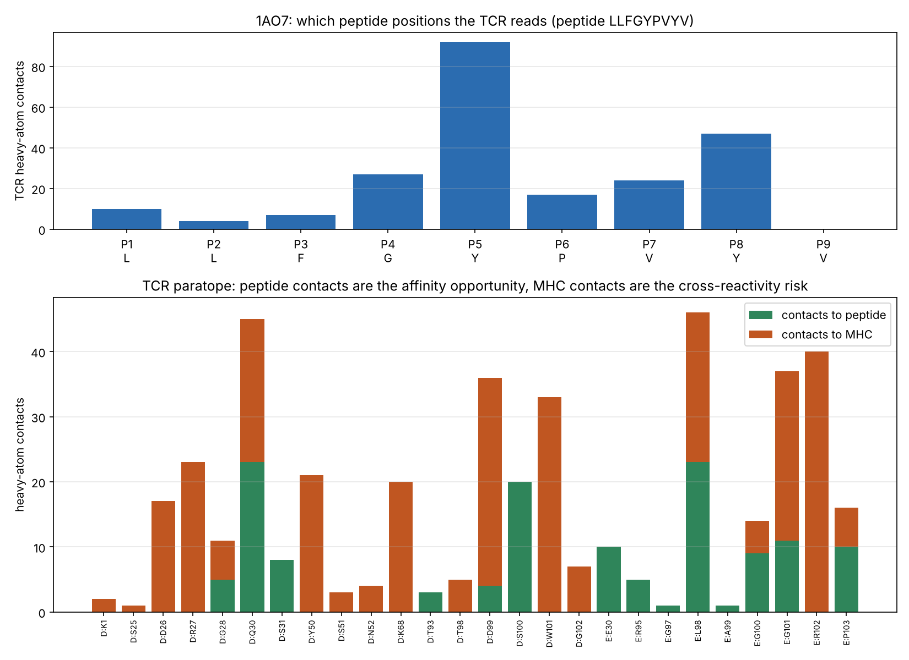
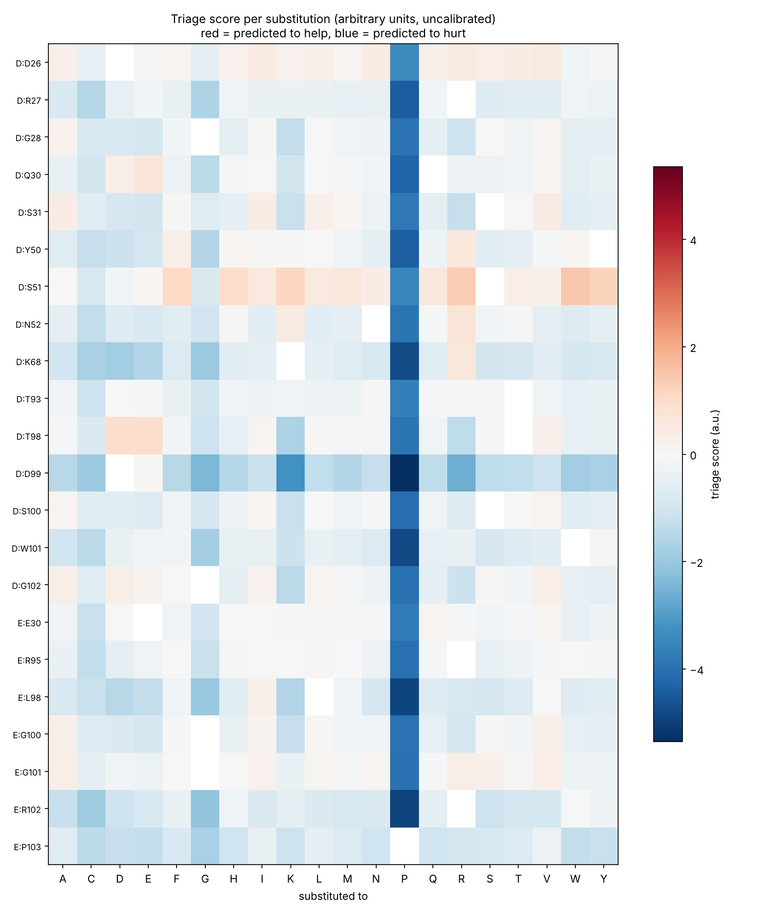
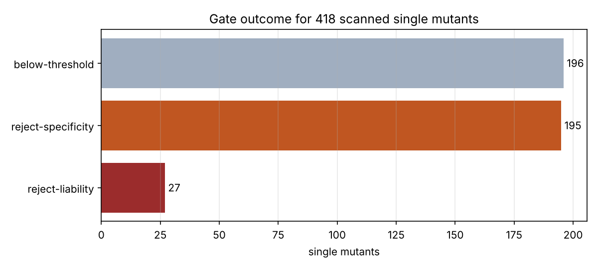

# TCR interface triage: 1AO7

Generated by `tcr_design`. Every claim below is labelled:

* `[measured]` direct measurement of the deposited structure
* `[heuristic]` uncalibrated heuristic: it ranks, it does not predict
* `[needs external tool]` needs a tool or experiment this package does not run

## 1. System

| role | chain | length |
|---|---|---|
| mhc | A | 274 |
| b2m | B | 100 |
| peptide | C | 9 |
| tcr_alpha | D | 115 |
| tcr_beta | E | 209 |

Peptide: `LLFGYPVYV`

Chain typing decisions:

* chain A -> MHC class I heavy chain (sequence fingerprint)
* chain B -> beta-2 microglobulin (sequence fingerprint)
* chain E -> TCR beta (TRBC constant domain) (sequence fingerprint)
* TCR alpha/beta resolved by docking geometry: D
* chain C -> peptide (9 aa, 318 heavy-atom contacts to MHC)

CDR loops located from the conserved V-domain anchors (IMGT junction definition for CDR3):

| loop | chain | sequence |
|---|---|---|
| A-CDR1 | D | `DRGSQS` |
| A-CDR3 | D | `CAVTTDSWGKLQF` |
| B-CDR1 | E | `MNHEY` |
| B-CDR3 | E | `CASRPGLAGGRPEQYF` |

## 2. Interface geometry `[measured]`

* Paratope: **26 TCR residues** contact the pMHC (heavy-atom cutoff 5 A).
* Buried TCR surface on binding: **993 A^2**. Typical TCR-pMHC interfaces bury roughly 600-1000 A^2 per side, so this is a normal interface.
* Peptide positions the receptor reads hardest: P5Y (92), P8Y (47), P4G (27), P7V (24).

The peptide/MHC split of each paratope residue's contacts is the key number for everything that follows. Affinity added at peptide-contacting positions sharpens recognition; affinity added at MHC-contacting positions broadens it.

Full per-residue measurements: `interface_residues.csv`

## 3. Mutation scan `[heuristic]`

Scanned **418 single mutants** across the contacting CDR positions.

The score is a weighted sum of six terms. The weights were set by hand from interface-energetics principles and **were not fitted to any affinity data**:

| term | weight | what it measures |
|---|---|---|
| packing | 1.0 | side-chain volume change against measured local void |
| apolar_burial | 1.5 | hydropathy change scaled by measured burial |
| electrostatic | 1.0 | charge complementarity to nearby partner side chains |
| hbond | 0.8 | donor/acceptor change against partner polar atoms |
| conformational | 1.0 | proline/glycine backbone penalties |
| substitution_prior | 0.3 | BLOSUM62 plausibility, as a fold/expression proxy |

Scores are reported in arbitrary units plus a z-score. Positions that touch the peptide are z-scored against each other, because across a whole TCR-pMHC interface the MHC-contacting positions would otherwise dominate the ranking.

### Gate outcomes

| verdict | count |
|---|---|
| below-threshold | 196 |
| reject-specificity | 195 |
| reject-liability | 27 |

### Advance

Clean, peptide-focused, and predicted to tighten binding. These are the candidates worth spending real compute on. When this list is empty, the best surviving candidates are still handed to tier 2: the calibrated model is known to under-call real improvements, so an empty list is a reason to spend the compute rather than to stop.

_none_

### Watch for specificity

Predicted gain, but the position leans on MHC contacts.

_none_

### Rejected on specificity

These score well and are still rejected: their contacts are almost entirely to MHC rather than the peptide, so any affinity they buy is peptide-independent. This is the dominant outcome of the scan and it is the main result worth taking away.

| mutant | loop | predicted ddG | score (a.u.) | z | pep contacts | MHC contacts | MHC frac | buried | why |
|---|---|---|---|---|---|---|---|---|---|
| `D:S51W` | A-CDR2 | -0.52 | +1.46 | +2.01 | 0 | 3 | 1.00 | 0.18 | aromatic insertion into available interface volume |
| `D:S51R` | A-CDR2 | -0.05 | +1.36 | +1.91 | 0 | 3 | 1.00 | 0.18 | complementary charge pairing with the partner surface |
| `D:S51Y` | A-CDR2 | -0.37 | +1.18 | +1.74 | 0 | 3 | 1.00 | 0.18 | aromatic insertion into available interface volume |
| `D:S51K` | A-CDR2 | -0.18 | +1.14 | +1.70 | 0 | 3 | 1.00 | 0.18 | complementary charge pairing with the partner surface |
| `D:S51F` | A-CDR2 | -0.40 | +1.06 | +1.62 | 0 | 3 | 1.00 | 0.18 | aromatic insertion into available interface volume |
| `D:S51H` | A-CDR2 | -0.12 | +0.97 | +1.54 | 0 | 3 | 1.00 | 0.18 | aromatic insertion into available interface volume |
| `D:T98D` | A-CDR3 | +0.51 | +0.95 | +1.52 | 0 | 5 | 1.00 | 0.63 | complementary charge pairing with the partner surface |
| `D:T98E` | A-CDR3 | +0.36 | +0.92 | +1.49 | 0 | 5 | 1.00 | 0.63 | no room to enlarge side chain (steric clash likely) |

## 4. Off-target screen `[heuristic]`

Peptide positions are weighted by measured TCR contact, filtered to those the HLA allele could present, and matched against the reviewed human proteome. Identity is required at the most heavily contacted position(s).

| parameter | value |
|---|---|
| target peptide | `LLFGYPVYV` |
| weighted positions | P1L, P2L, P3F, P4G, P5Y, P6P, P7V, P8Y |
| identity required at | P5Y |
| HLA anchor filter | {'P2': 'AILMQTV', 'P9': 'AILMTV'} |
| proteome windows scanned | 11,251,322 |
| passing all filters | 42,582 |
| above similarity 0.72 | 1,660 |

Top candidate human mimics:

| peptide | similarity | identical at contacts | pattern | gene | protein |
|---|---|---|---|---|---|
| `LAQGYPAYT` | 0.92 | 5 | `L--GYP-Y.` | ENOSF1 | Mitochondrial enolase superfamily member 1 |
| `LLEGYEIYV` | 0.91 | 5 | `LL-GY-iY.` | MDC1 | Mediator of DNA damage checkpoint protein 1 |
| `LLNNYPVYI` | 0.90 | 6 | `LL--YPVY.` | BEND4 | BEN domain-containing protein 4 |
| `QAKGYPTYT` | 0.90 | 4 | `---GYP-Y.` | VILL | Villin-like protein |
| `VTLAYPVYA` | 0.89 | 4 | `v---YPVY.` | PIK3R1 | Phosphatidylinositol 3-kinase regulatory subunit |
| `FIQGYHVYL` | 0.89 | 4 | `-i-GY-VY.` | OSMR | Oncostatin-M-specific receptor subunit beta |
| `QVTGYAVYA` | 0.89 | 4 | `-v-GY-VY.` | RIMBP3 | RIMS-binding protein 3A |
| `QVTGYAVYA` | 0.89 | 4 | `-v-GY-VY.` | RIMBP3C | RIMS-binding protein 3C |
| `QVTGYAVYA` | 0.89 | 4 | `-v-GY-VY.` | RIMBP3B | RIMS-binding protein 3B |
| `LMVPYPVYT` | 0.88 | 5 | `Lm--YPVY.` | CCKBR | Gastrin/cholecystokinin type B receptor |
| `PQLGYPQYL` | 0.88 | 4 | `---GYP-Y.` | IRX1 | Iroquois-class homeodomain protein IRX-1 |
| `CLFGYDAYV` | 0.88 | 5 | `-LFGY--Y.` | PLP2 | Proteolipid protein 2 |
| `LTLGYVLYA` | 0.88 | 4 | `L--GY-lY.` | SMPD4 | Sphingomyelin phosphodiesterase 4 |
| `RVTGYAIYA` | 0.88 | 3 | `-v-GY-iY.` | TSPOAP1 | Peripheral-type benzodiazepine receptor-associat |
| `NVTGYGVYA` | 0.88 | 4 | `-v-GY-VY.` | RIMBP2 | RIMS-binding protein 2 |

Full list: `offtarget_candidates.csv`

**What this list is.** A prioritised shortlist of human peptides that resemble the target at the positions this receptor actually reads. The pattern column shows per-position agreement: uppercase identical, lowercase conservative, `-` non-conservative, `.` unweighted.

**What this list is not.** A cross-reactivity prediction. The motif comes from one crystal structure rather than from an experimental scan of the receptor; presentation is filtered by a coarse anchor motif rather than scored with NetMHCpan; and the screen covers only the canonical reviewed proteome, so isoforms, modified peptides and non-canonical products are invisible to it. `[needs external tool]`

This step is included because it is the one that cannot be skipped. An affinity-enhanced MAGE-A3 TCR cross-reacted with a titin peptide and killed two patients; the peptide was found only on retrospective review, and it was invisible both in cardiac cell lines and in mouse models. A published tool, CrossDome, implements the same contact-weighting idea more thoroughly and moved that titin peptide from rank 27 to rank 6 of 36,000 candidates.

## 5. What to run next `[needs external tool]`

Tier-2 inputs for every advancing candidate are in `tier2/`, with exact commands in `tier2/RUN_TIER2.md`:

* AlphaFold3 and Boltz co-folding inputs for each mutant complex
* Rosetta resfiles for flex ddG
* a FoldX `individual_list.txt`
* ProteinMPNN chain and fixed-position files for CDR loop redesign

Order of trust for this problem, based on published TCR-specific validation: MM/PBSA against ATLAS mutants (r = 0.74-0.9, small n) > Rosetta flex ddG (well validated on general interfaces, no TCR benchmark) > FoldX > co-folding confidence scores (which are not affinity). None of these replace a binding measurement.

## 6. Honest limits of this pipeline

**Both the heuristic and the calibrated model fail the retrospective benchmark.** The one test buildable from public structures is the DMF5 TCR: `3QDG` is wild type and `4L3E` is a designed variant reported at roughly 400-fold improved affinity with retained specificity. The two substitutions that achieved it (alpha D26Y in CDR1, beta L98W in CDR3) rank in the 47th and 44th percentile of a blind scan with the raw heuristic, and the 25th and 26th with the calibrated model refitted without those structures. Calibration roughly halves the percentile, and L98W becomes the top-ranked substitution of 19 at its own position, but both are still predicted to *weaken* binding when D26Y in fact tightens it by about 1.8 kcal/mol. Neither would have been shortlisted. Run `python -m tcr_design validate 3QDG 4L3E --calibrated` to reproduce it.

* Against pooled ATLAS and SKEMPI measurements the calibrated model reaches a held-out Spearman of about +0.43 and an RMSE near 0.88 kcal/mol, versus 0.98 for predicting the mean. That is real but weak, and its predictions are compressed towards the middle of the range, so it rarely calls anything strongly stabilising.
* The benchmark behind it is dominated by alanine scanning, so the model mostly learned that deleting a buried side chain weakens binding. Adding volume to gain affinity is the rarer direction and the one design needs.
* The raw triage score is unfitted. Against the same measurements its correlation with ddG is about -0.08, which is no signal at all; refitting its six weights does not beat predicting the mean. Treat it as a way to allocate compute, never as a result.
* The specificity gate uses contact partitioning in a single wild-type structure as a proxy for cross-reactivity risk. The DMF5 case above shows that proxy is crude: an MHC-contacting position can be enhanced without losing specificity. The gate raises a flag for triage, it does not establish risk.
* Single point mutations only. Real affinity maturation explores combinations, and the best published TCR design result came from structure-based physics plus wet-lab iteration, not from a one-shot scan.
* One static structure. Side-chain and loop rearrangement on binding is not modelled, and TCR CDR3 loops are flexible.
* No expression, pairing, stability or immunogenicity assessment.
* Higher affinity is not automatically better: very high affinity can reduce T cell activity, and affinity enhancement is what produced the best-known off-target fatality in this field.

